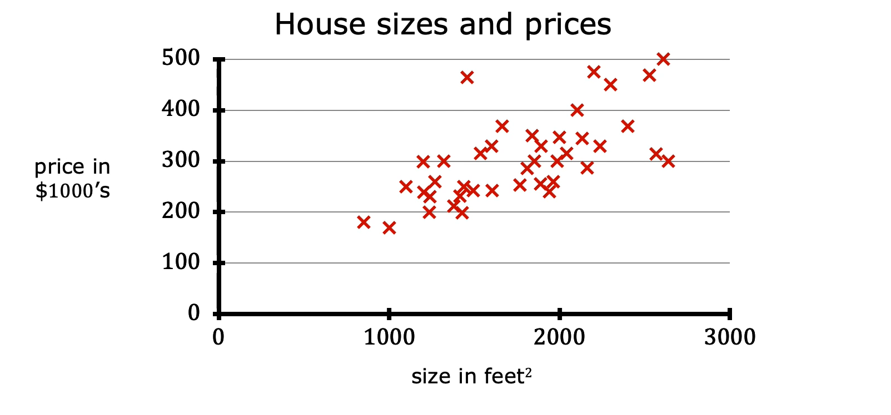
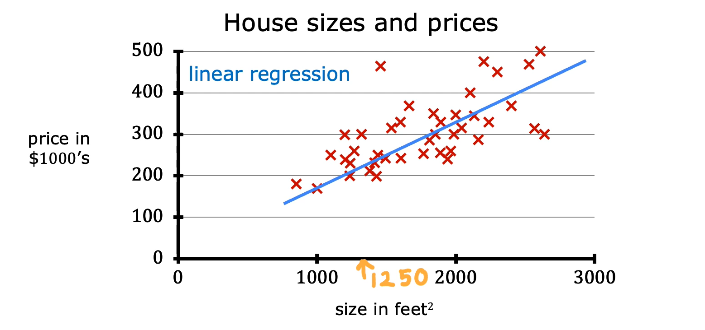
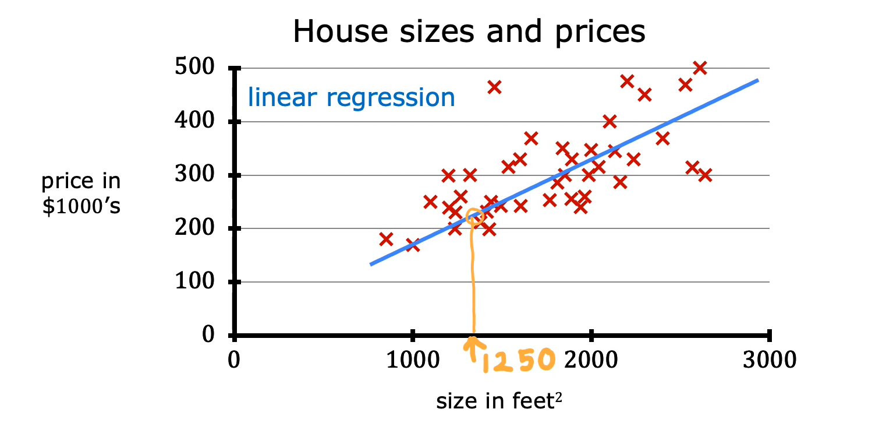
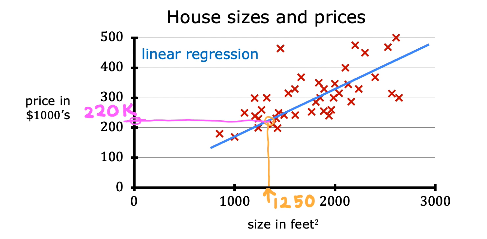
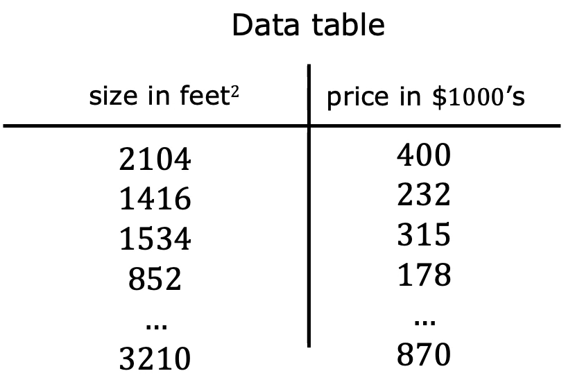

# Linear Regression with One Variable

## 1. Linear Regression with One Variable

- Linear regression with one variable involves fitting a straight line to data.
- **Problem:** Predict the price of a house based on its size.
- A dataset containing house sizes and their corresponding prices from Portland, a city in the United States, is used for this example.

### How Linear Regression Works

- Let's say we want to predict the price of a house with a size of 1,250 ft².
- We build a linear regression model using the dataset, which fits a straight line to the data.

- Based on the straight line fitted to the data, we locate the house size of 1,250 ft² on the horizontal axis.
- This point intersects the best-fit line at a particular location.

- From the intersection point, we trace horizontally toward the vertical axis on the left to estimate the house price.
- The predicted price is approximately **$220,000**.

### Regression Problem

- Any supervised learning model that predicts a numerical value is addressing what is called a **regression problem**.
- The predicted value can be any numerical quantity, such as:
  - 220,000
  - 1.5
  - -33.2

## 2. Training Set

- Another useful way of looking at the dataset is through a data table.

- The dataset comprises two main components:
  - **Inputs:** The size of each house.
  - **Outputs:** The corresponding price of each house.
- Each row represents a training example containing an input and its corresponding output.

## 3. Terminology

### 3.1 Training Set

- The dataset used to train the machine learning model is called the **training set**.
- It contains examples that the learning algorithm uses to learn the relationship between inputs and outputs.

### 3.2 Input Variable — `x`

- The standard notation used to represent the input variable is lowercase `x`.
- It is also called a **feature** or **input feature**.
- In the house price prediction example, `x` represents the size of the house.
- For the first training example:
  - `x = 2104`

### 3.3 Output Variable — `y`

- The standard notation used to represent the output variable is lowercase `y`.
- It is also called the **target variable**.
- In the house price prediction example, `y` represents the price of the house.
- For the first training example:
  - `y = 400`

### 3.4 Number of Training Examples — `m`

- Lowercase `m` is used to represent the total number of training examples in the dataset.
- In the Portland housing dataset:
  - `m = 47`

### 3.5 Training Example — `(x, y)`

- The notation `(x, y)` is used to represent a single training example.
- It consists of an input variable `x` and its corresponding output variable `y`.
- For the first training example:
  - `x = 2104`
  - `y = 400`
- Therefore:
  - `(x, y) = (2104, 400)`

### 3.6 Specific Training Example — `(x⁽ⁱ⁾, y⁽ⁱ⁾)`

- To refer to a specific training example, we use the notation `(x⁽ⁱ⁾, y⁽ⁱ⁾)`.
- Here, `i` represents the index of a specific training example in the dataset.
  - `i = 1` refers to the first training example.
  - `i = 2` refers to the second training example.
  - `i = 3` refers to the third training example.
- Each index corresponds to a specific row in the training set.

**Example: First Training Example**

- For the first training example, `i = 1`.
- Therefore:
  - `x⁽¹⁾ = 2104`
  - `y⁽¹⁾ = 400`
- The notation becomes:
  - `(x⁽¹⁾, y⁽¹⁾) = (2104, 400)`

**Important Note:**

- The superscript in parentheses is not exponentiation.
- It represents the index of the training example in the dataset.
- For example, `x⁽²⁾` refers to the input value of the second training example, not `x` raised to the power of 2.

### Summary of Notation

| Notation       | Meaning                           |
| -------------- | --------------------------------- |
| `x`            | Input variable or feature         |
| `y`            | Output variable or target         |
| `m`            | Total number of training examples |
| `(x, y)`       | A single training example         |
| `(x⁽ⁱ⁾, y⁽ⁱ⁾)` | The i-th training example         |
| `i`            | Index of a training example       |

## 4. Key Takeaways

- Linear regression with one variable fits a straight line to data.
- It is a supervised learning algorithm used to predict numerical values.
- A regression problem involves predicting a numerical output.
- A training set is the dataset used to train the model.
- `x` represents the input feature, while `y` represents the target variable.
- `m` represents the total number of training examples.
- `(x⁽ⁱ⁾, y⁽ⁱ⁾)` represents a specific training example, where `i` is its index in the dataset.
