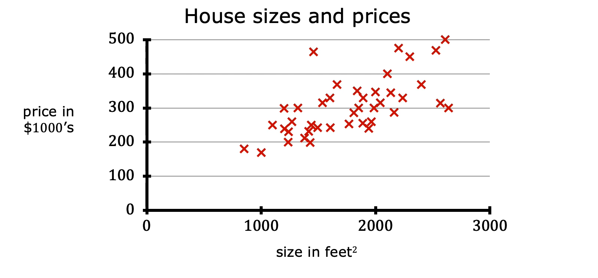
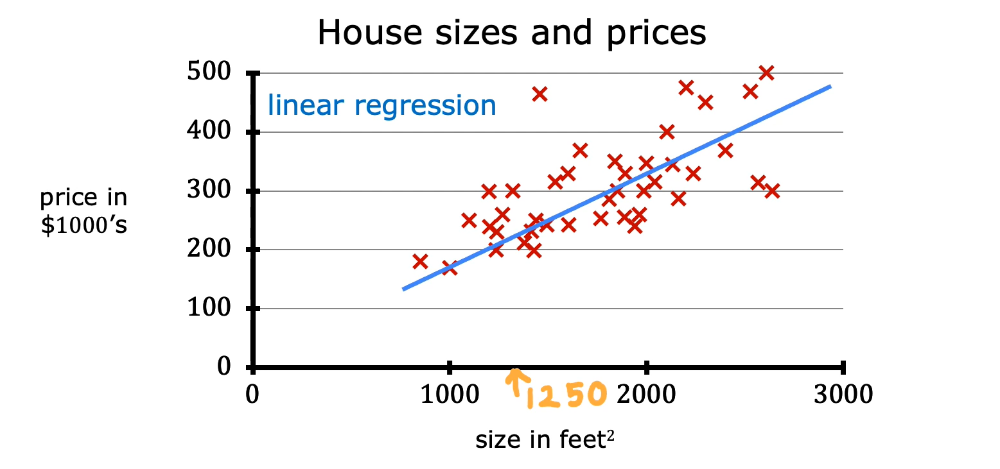
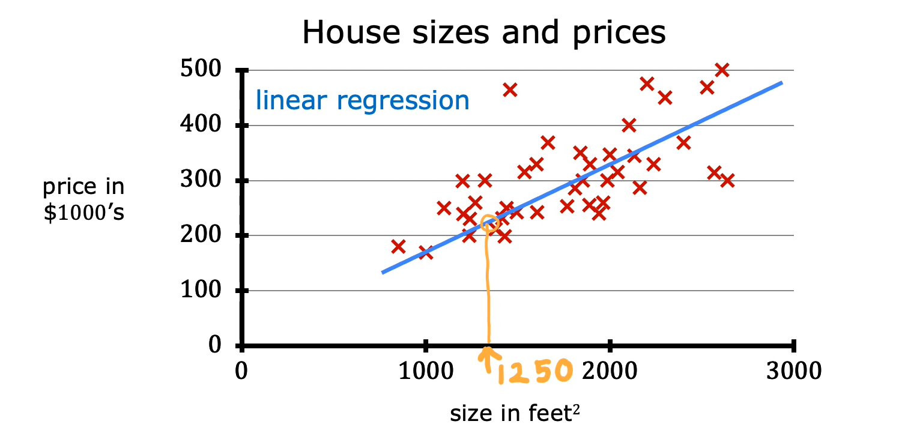
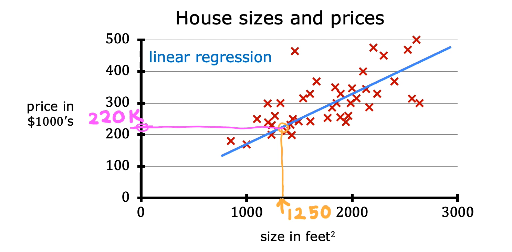
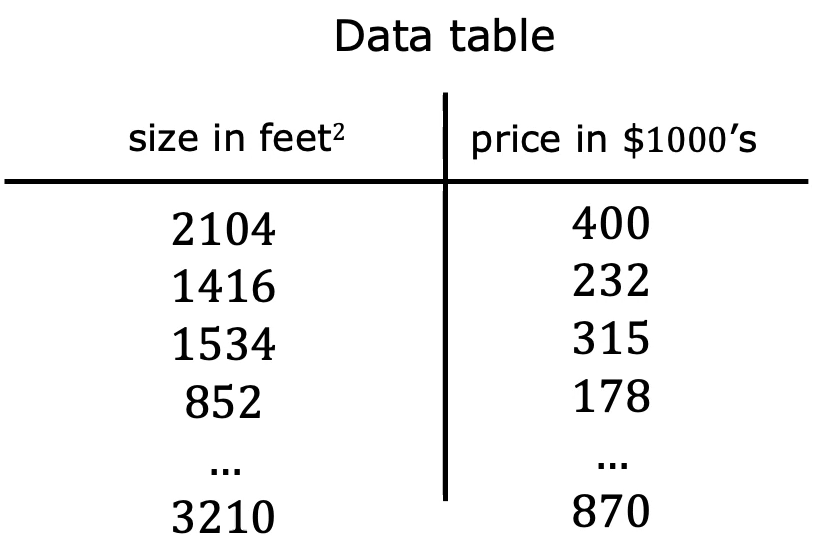
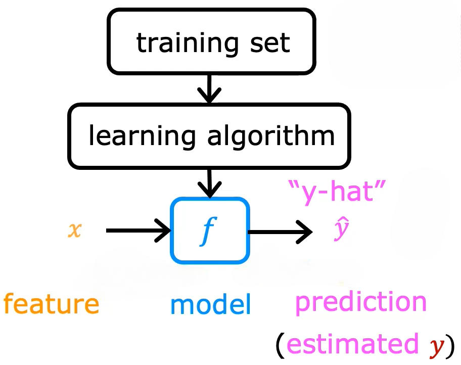
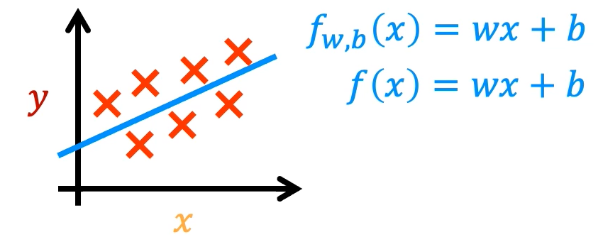

# Linear Regression with One Variable

## 1. Introduction to Linear Regression

- Linear regression involves fitting a straight line to data to make predictions.
- **Problem:** Predict the price of a house based on its size.
- A dataset containing house sizes and their corresponding prices from Portland, a city in the United States, is used for this example.

### How Linear Regression Works

- Let's say we want to predict the price of a house with a size of 1,250 ft².
- We use the dataset to train a linear regression model, which learns a straight line that fits the data.

- Based on the fitted line, we locate the house size of 1,250 ft² on the horizontal axis.
- This point intersects the fitted line at a particular location.

- From the intersection point, we trace horizontally toward the vertical axis on the left to estimate the house price.
- The predicted price is approximately **$220,000**.

### Regression Problem

- A supervised learning problem that involves predicting a numerical value is called a **regression problem**.
- The predicted value can be any numerical quantity, such as:
  - 220,000
  - 1.5
  - -33.2
- In contrast, a **classification problem** involves predicting a category or class from a finite set of possible outputs, such as identifying whether a tumor is benign or malignant.

## 2. Training Set

- A dataset used to train a machine learning model is called a **training set**.
- It contains examples that the learning algorithm uses to learn the relationship between inputs and their corresponding outputs.
- Each row represents a training example containing an input and its corresponding output.

The training set consists of two main components:

- **Input features:** The information provided to the learning algorithm, such as the size of each house.
- **Output targets:** The corresponding correct answers, such as the actual price of each house.

## 3. Terminology and Notation

### 3.1 Input Variable — `x`

- The standard notation used to represent an input variable is lowercase `x`.
- It is also called a **feature** or **input feature**.
- In the house price prediction example, `x` represents the size of the house.
- For the first training example:
  - `x = 2104`

### 3.2 Output Variable — `y`

- The standard notation used to represent an output variable is lowercase `y`.
- It is also called the **target variable** or **output target**.
- In the house price prediction example, `y` represents the actual price of the house.
- For the first training example:
  - `y = 400`

### 3.3 Number of Training Examples — `m`

- Lowercase `m` represents the total number of training examples in the dataset.
- In the Portland housing dataset:
  - `m = 47`

### 3.4 Training Example — `(x, y)`

- The notation `(x, y)` represents a single training example.
- It consists of an input variable `x` and its corresponding output variable `y`.
- For the first training example:
  - `x = 2104`
  - `y = 400`
- Therefore:
  - `(x, y) = (2104, 400)`

### 3.5 Specific Training Example — `(x⁽ⁱ⁾, y⁽ⁱ⁾)`

- To refer to a specific training example, we use the notation `(x⁽ⁱ⁾, y⁽ⁱ⁾)`.
- Here, `i` represents the index of a specific training example in the dataset.
  - `i = 1` refers to the first training example.
  - `i = 2` refers to the second training example.
  - `i = 3` refers to the third training example.
- Each index corresponds to a specific row in the training set.

**Example: First Training Example**

- For the first training example, `i = 1`.
- Therefore:
  - `x⁽¹⁾ = 2104`
  - `y⁽¹⁾ = 400`
- The notation becomes:
  - `(x⁽¹⁾, y⁽¹⁾) = (2104, 400)`

**Important Note:**

- The superscript in parentheses is not exponentiation.
- It represents the index of the training example in the dataset.
- For example, `x⁽²⁾` refers to the input value of the second training example, not `x` raised to the power of 2.

## 4. How Supervised Learning Works

The supervised learning process involves using a training set to produce a model that can make predictions for new inputs.

1. **Provide the training set:** The learning algorithm receives the input features and their corresponding output targets.
2. **Learn from the examples:** The algorithm uses these input-output pairs to learn a relationship between the inputs and outputs.
3. **Produce a model:** The learning algorithm produces a function, represented by `f`.
4. **Make predictions:** The model takes a new input `x` and produces an estimated output, represented by `ŷ`.

### Model — `f`

- The function produced by the learning algorithm is called the **model**.
- Historically, this function was also called a _hypothesis_.
- The model takes an input feature `x` and produces a prediction.
- Its purpose is to estimate the output target for a given input.

### Prediction — `ŷ` (Y-Hat)

- The notation `ŷ` (y-hat) represents the **predicted or estimated value** of the output variable `y`.
- It is important to distinguish between the actual target and the model's prediction:
  - `y` represents the actual target value.
  - `ŷ` represents the model's estimated value.
- A prediction may or may not match the actual target value.
- In the house price prediction example, the actual selling price is unknown until the house is sold. Therefore, the model produces an estimated price based on the house's size.

## 5. Representing the Model as a Function

When designing a learning algorithm, one important question is how to represent the function `f`, or what mathematical formula to use to compute it.

For now, let's represent the function using a straight line:

**Linear Function:**

\[
f\_{w,b}(x) = wx + b
\]

Here:

- `w` and `b` are numerical values.
- The values of `w` and `b` determine the prediction `ŷ` based on the input feature `x`.

The function can also be written more simply as:

\[
f(x) = wx + b
\]

Both notations represent the same function. The shorter notation omits `w` and `b` from the subscript for simplicity.

### Visualizing the Function

We can plot the training set on a graph, with the input feature `x` on the horizontal axis and the output target `y` on the vertical axis.

The learning algorithm learns from the data and generates a best-fit line. This straight line represents the function defined above and makes predictions for the value of `y` using a straight-line relationship with `x`.

Although more complex nonlinear functions, such as curves or parabolas, can also be used to fit data, we will use a linear function for now. A straight line is relatively simple and easy to work with, making it a useful foundation for understanding more complex nonlinear models later.

### Linear Regression with One Variable

- The particular model above is called **linear regression**.
- More specifically, it is called **linear regression with one variable** because it uses a single input feature.
- In the house price prediction example, the only input feature is the size of the house.
- It is also known as **univariate linear regression**:
  - **Uni** means one.
  - **Variate** means variable.
- Therefore, _univariate_ means one variable.

## 6. Summary of Notation

| Notation       | Meaning                                   |
| -------------- | ----------------------------------------- |
| `x`            | Input variable or feature                 |
| `y`            | Actual output variable or target          |
| `ŷ`            | Predicted or estimated output             |
| `m`            | Total number of training examples         |
| `(x, y)`       | A single training example                 |
| `(x⁽ⁱ⁾, y⁽ⁱ⁾)` | The i-th training example                 |
| `i`            | Index of a training example               |
| `f`            | Model or function                         |
| `f(x)`         | Model's prediction for input `x`          |
| `w`, `b`       | Parameters of the linear regression model |

## 7. Key Takeaways

- Linear regression with one variable fits a straight line to data to predict numerical values.
- A regression problem involves predicting a numerical output, whereas a classification problem involves predicting a category.
- A training set contains input features and their corresponding output targets.
- The supervised learning algorithm uses the training set to produce a model represented by the function `f`.
- `x` represents the input feature, `y` represents the actual target, and `ŷ` represents the predicted output.
- `m` represents the total number of training examples.
- `(x⁽ⁱ⁾, y⁽ⁱ⁾)` represents a specific training example, where `i` is its index in the dataset.
- Linear regression with one input feature is also called univariate linear regression.
- The model uses the function `f(x) = wx + b` to make predictions.
