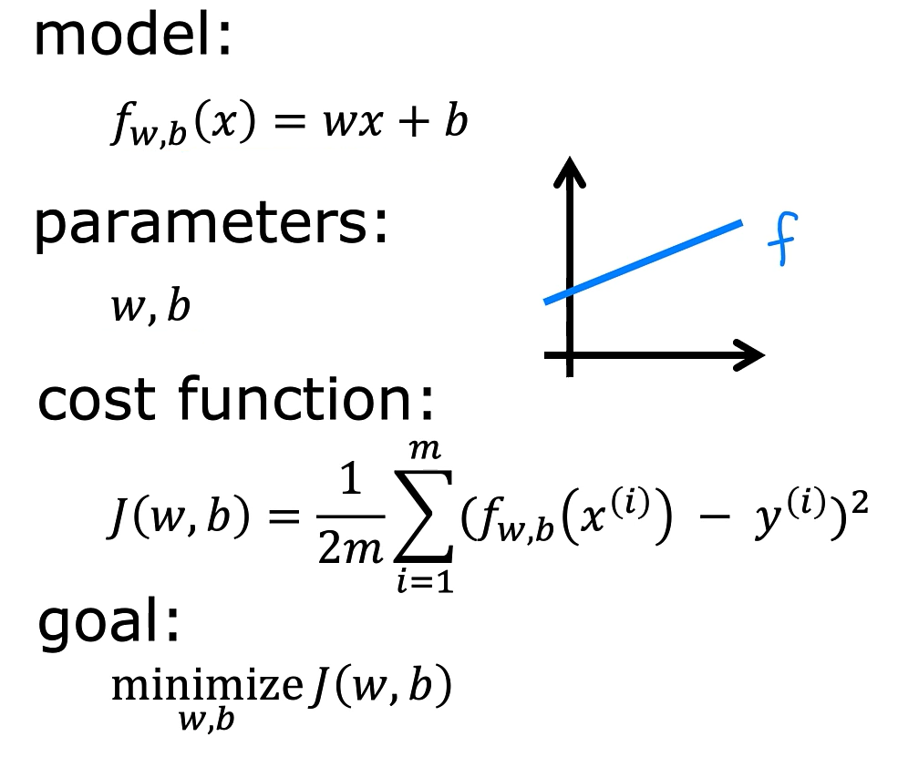
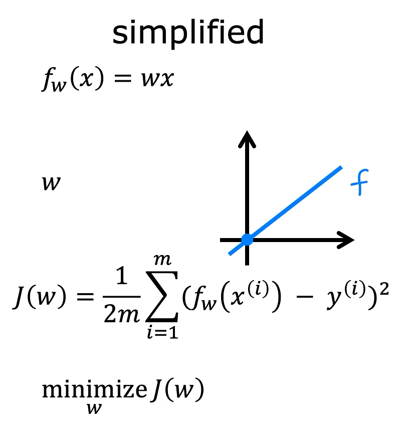
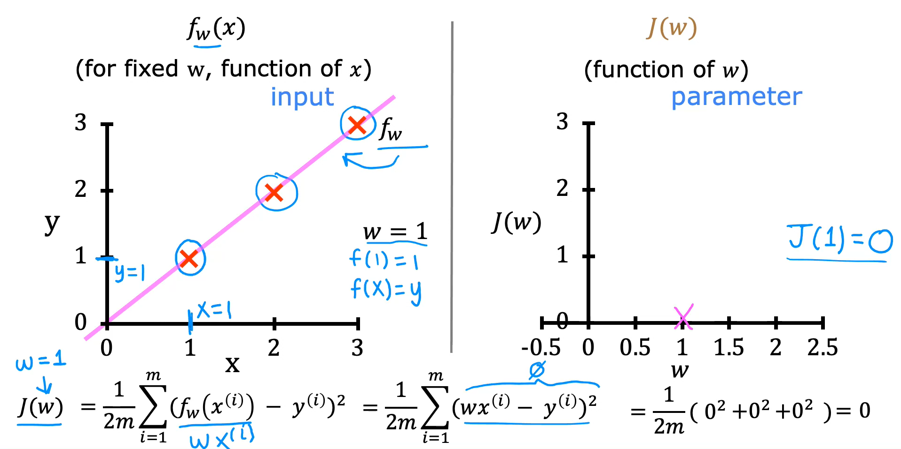
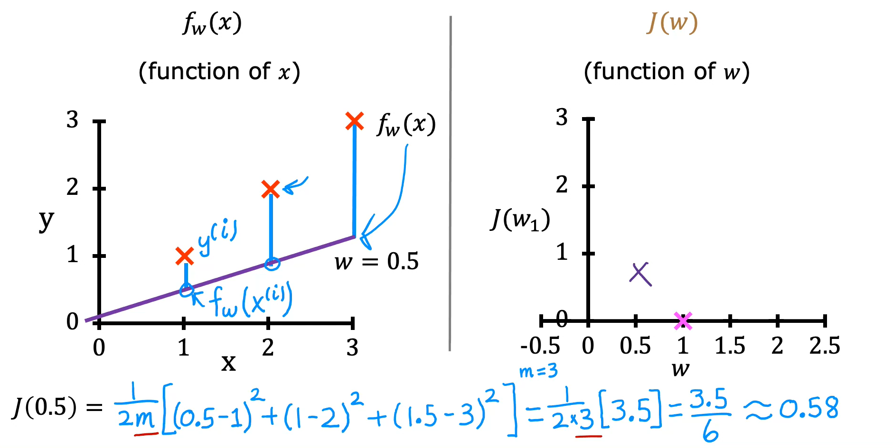
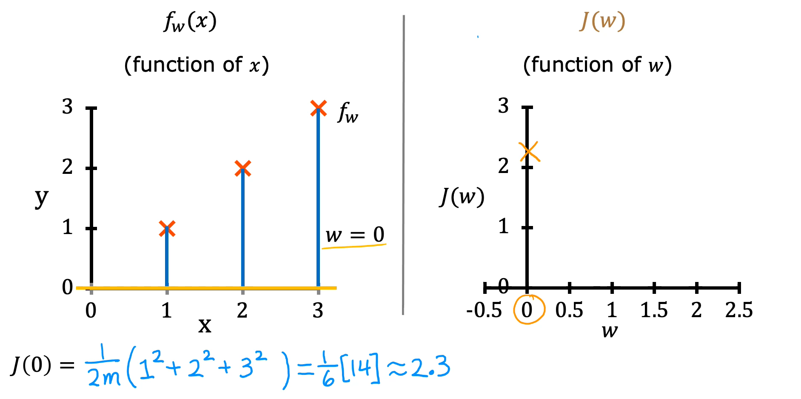
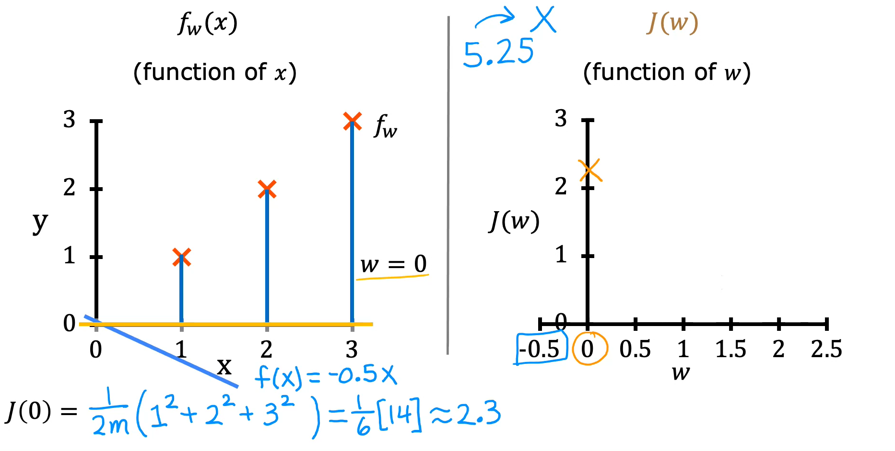
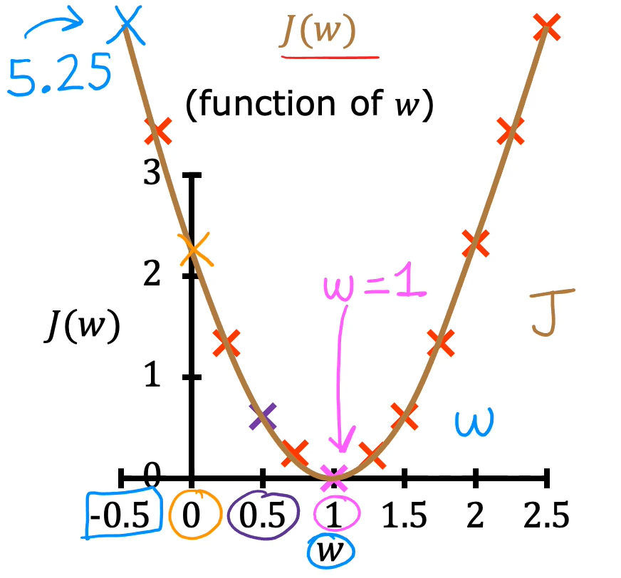

# Cost Function Intuition

The cost function measures how well a linear regression model fits the training data. Understanding how different parameter values affect the prediction line and its corresponding cost helps identify the parameters that minimize the cost function.

## 1. Recap: Linear Regression and Cost Function

In linear regression, the goal is to fit a straight line to the training data using the model:

$$
f_{w,b}(x) = wx + b
$$

The model has two parameters:

- **w:** Determines the slope of the line.
- **b:** Determines the y-intercept of the line.

Different values of these parameters produce different straight lines. The goal is to find values of `w` and `b` that make the line fit the training data well.

The cost function, denoted by $J(w,b)$, measures how well the model's predictions match the actual target values. It measures the squared differences between the predicted values and the actual values.

Therefore, the goal of linear regression is to find the parameters that minimize the cost function:

$$
\underset{w,b}{\text{minimize}} \ J(w,b)
$$

## 2. Simplified Linear Regression Model

To better visualize the cost function, a simplified version of linear regression can be used by setting the parameter `b` to zero.

The original model:

$$
f_{w,b}(x) = wx + b
$$

Simplified model:

$$
f_w(x) = wx
$$

By setting `b = 0`, the model has only one parameter, `w`.

This means that the goal is now to find the value of `w` that minimizes the cost function:

$$
\underset{w}{\text{minimize}} \ J(w)
$$

Since the model is $f_w(x) = wx$, its prediction line always passes through the origin `(0, 0)`. This is because when `x = 0`, the predicted value is also zero.

## 3. Model Function and Cost Function Graphs

The model function and the cost function can be plotted side by side to understand their relationship.

### Model Function: $f_w(x)$

- The horizontal axis represents the input feature `x`.
- The vertical axis represents the predicted output value `y`.
- For a fixed value of `w`, the model defines a straight line.
- Changing `w` changes the slope of the line.

### Cost Function: $J(w)$

- The horizontal axis represents the parameter `w`.
- The vertical axis represents the cost `J(w)`.
- Each value of `w` produces one corresponding cost value.
- The cost depends on how well the prediction line fits the training data.

The important distinction is that the model function is a function of `x`, while the cost function is a function of the parameter `w`.

## 4. Worked Example: Understanding Different Values of w

Consider a training set containing three examples:

| Training Example | Input Feature (x) | Output Target (y) |
| ---------------- | ----------------: | ----------------: |
| 1                |                 1 |                 1 |
| 2                |                 2 |                 2 |
| 3                |                 3 |                 3 |

Here, the number of training examples is:

$$
m = 3
$$

For the simplified model $f_w(x) = wx$, the squared error cost function becomes:

$$
J(w) = \frac{1}{2m}\sum_{i=1}^{m}(wx^{(i)}-y^{(i)})^2
$$

We can calculate the cost for different values of `w` and observe how the prediction line and its corresponding cost change.

### Example 1: When w = 1

The model becomes:

$$
f_w(x) = 1x = x
$$

The predictions are:

|   x | Actual Value (y) | Predicted Value (f(x)) | Squared Error |
| --: | ---------------: | ---------------------: | ------------: |
|   1 |                1 |                      1 | $(1-1)^2 = 0$ |
|   2 |                2 |                      2 | $(2-2)^2 = 0$ |
|   3 |                3 |                      3 | $(3-3)^2 = 0$ |

All predictions match the actual target values.

Therefore:

$$
J(1) = \frac{1}{6}(0+0+0) = 0
$$

The cost is zero because the prediction line passes through all three training examples.

### Example 2: When w = 0.5

The model becomes:

$$
f_w(x) = 0.5x
$$

The predictions are:

|   x | Actual Value (y) | Predicted Value (f(x)) |      Squared Error |
| --: | ---------------: | ---------------------: | -----------------: |
|   1 |                1 |                    0.5 | $(0.5-1)^2 = 0.25$ |
|   2 |                2 |                      1 |      $(1-2)^2 = 1$ |
|   3 |                3 |                    1.5 | $(1.5-3)^2 = 2.25$ |

The difference between the predicted value and actual value is the vertical distance between the prediction line and each training example.

The cost function sums the squared errors:

$$
J(0.5) = \frac{1}{6}(0.25+1+2.25)
$$

$$
J(0.5) = \frac{3.5}{6} \approx 0.58
$$

The cost is approximately `0.58`.

### Example 3: When w = 0

The model becomes:

$$
f_w(x) = 0
$$

The prediction line is a horizontal line along the x-axis.

The predictions are all zero, so the cost becomes:

$$
J(0) = \frac{1}{6}(1^2+2^2+3^2)
$$

$$
J(0) = \frac{14}{6} \approx 2.33
$$

The cost is approximately `2.33`.

### Example 4: When w = -0.5

The model becomes:

$$
f_w(x) = -0.5x
$$

The prediction line now has a negative slope, meaning the predicted output decreases as the input feature increases.

For this parameter value, the cost is approximately:

$$
J(-0.5) = 5.25
$$

This is a higher cost than the previous examples, indicating that the prediction line fits the training data poorly.

## 5. Visualizing the Cost Function

By calculating the cost for different values of `w`, we can plot the corresponding points on the cost function graph.

Each value of `w` corresponds to:

1. A particular straight-line prediction model.
2. A single cost value calculated using that model and the training data.
3. A corresponding point on the graph of $J(w)$.

The calculated values from the examples are:

| Parameter (w) | Cost (J(w)) |
| ------------: | ----------: |
|          -0.5 |        5.25 |
|             0 |        2.33 |
|           0.5 |        0.58 |
|             1 |           0 |

Plotting these points and calculating costs for additional values of `w` allows us to trace out the cost function.

## 6. Choosing the Best Parameter

The goal is to choose the value of `w` that makes the cost function as small as possible.

A smaller cost means that the prediction line is closer to the training examples, while a larger cost indicates greater prediction errors.

In this example:

- When `w = 1`, the cost is `0`, and the prediction line fits all training examples exactly.
- When `w = 0.5`, the cost is approximately `0.58`.
- When `w = 0`, the cost is approximately `2.33`.
- When `w = -0.5`, the cost is approximately `5.25`.

Therefore, `w = 1` is the best choice among these examples because it produces the smallest cost.

## 7. Key Takeaways

- Each value of `w` produces a different straight-line prediction model.
- Each prediction model has a corresponding cost value calculated using the training data.
- The model function $f_w(x)$ depends on the input feature `x`.
- The cost function $J(w)$ depends on the parameter `w`.
- When the prediction line fits the training data well, the cost is small.
- The goal of linear regression is to find the parameter values that minimize the cost function.
- In the simplified model, only `w` is optimized. In the full linear regression model, both `w` and `b` are optimized.
