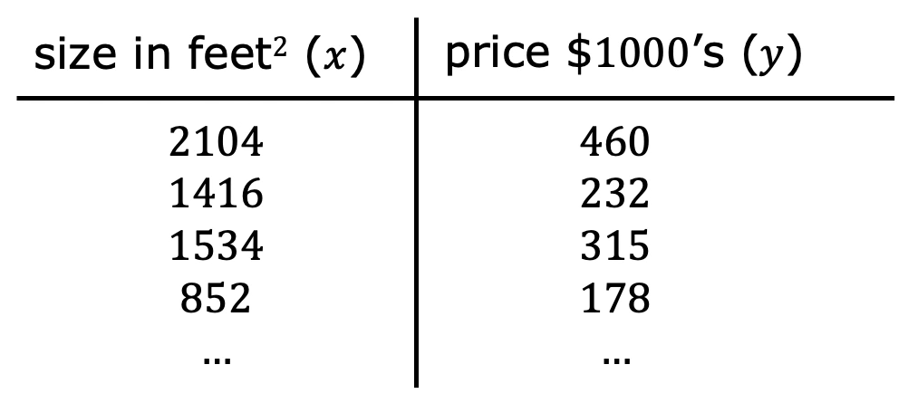
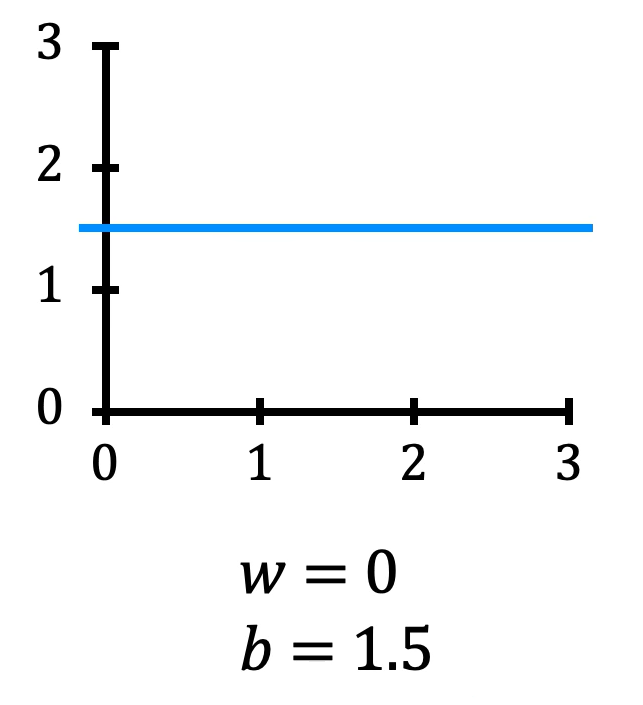
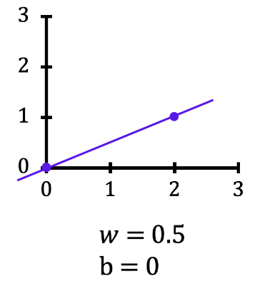
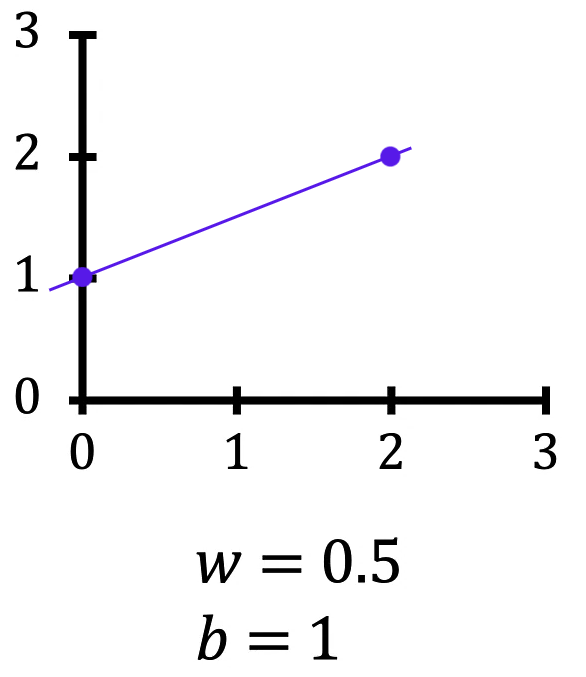
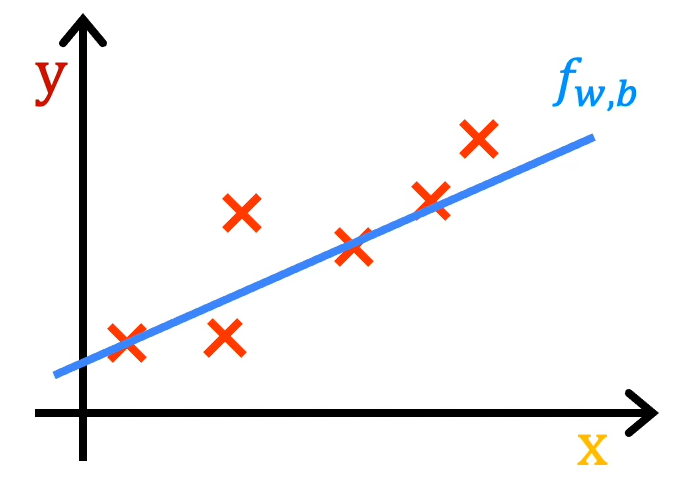
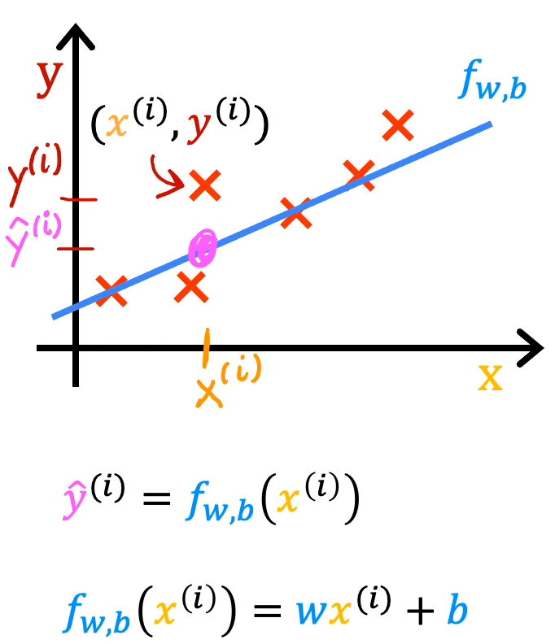
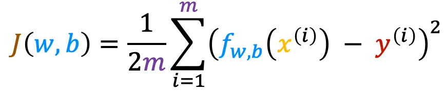

# Cost Function

To implement linear regression, the first key step is to define a cost function. The cost function tells us how well the model is performing so that we can try to improve it.

Recall that the training set contains input features `x` and output targets `y`.

The model used to fit this training set is the linear function:

$$
f_{w,b}(x) = wx + b
$$

## 1. Model Parameters

In the linear regression model, `w` and `b` are called **parameters**.

In machine learning, parameters are the variables that can be adjusted during training to improve the model. They are also sometimes referred to as **coefficients** or **weights**.

The values chosen for `w` and `b` determine the function `f(x)`, which generates a different straight line on the graph.

We can write $f(x)$ as a shorthand for $f_{w,b}(x)$.

## 2. How Parameters Determine the Line

Let's look at how different values of `w` and `b` affect the function and the line it produces.

### Example 1: w = 0, b = 1.5

When `w = 0` and `b = 1.5`, the function becomes:

$$
f(x) = 0x + 1.5
$$

Since `w` is zero, the function always produces the same prediction, regardless of the input `x`.

$$
\hat{y} = 1.5
$$

This produces a horizontal line at `y = 1.5`.

Here, `b` is called the **y-intercept** because it is the point where the line crosses the vertical axis (y-axis).

### Example 2: w = 0.5, b = 0

When `w = 0.5` and `b = 0`, the function becomes:

$$
f(x) = 0.5x
$$

For different input values:

- When `x = 0`, the prediction is `0.5 × 0 = 0`.
- When `x = 2`, the prediction is `0.5 × 2 = 1`.

This produces a straight line passing through `(0, 0)` and `(2, 1)`.

The slope of this line is `0.5`, which is determined by the value of `w`.

### Example 3: w = 0.5, b = 1

When `w = 0.5` and `b = 1`, the function becomes:

$$
f(x) = 0.5x + 1
$$

For different input values:

- When `x = 0`, the prediction is `1`.
- When `x = 2`, the prediction is `2`.

The line intersects the vertical axis at `1`, which is the y-intercept determined by `b`.

The slope remains `0.5` because the value of `w` has not changed.

These examples show that:

- `w` determines the slope of the line.
- `b` determines the y-intercept of the line.

Changing either parameter changes the function and therefore the line it produces.

## 3. Fitting the Training Data

Recall that we have a training set containing input features `x` and output targets `y`.

With linear regression, the goal is to choose values for the parameters `w` and `b` so that the straight line produced by the function `f` fits the training data well.

Visually, this means that the line should pass through or remain relatively close to the training examples compared with other possible lines that do not fit the points as closely.

### Prediction for a Training Example

A training example is represented by:

$$
(x^{(i)}, y^{(i)})
$$

Where:

- $x^{(i)}$ is the input feature of the training example.
- $y^{(i)}$ is the actual output target of the training example.

For a given input $x^{(i)}$, the model produces a predicted value:

$$
\hat{y}^{(i)} = f_{w,b}(x^{(i)})
$$

Since the model is a linear function:

$$
\hat{y}^{(i)} = wx^{(i)} + b
$$

The goal is to find values for `w` and `b` so that the predicted value $\hat{y}^{(i)}$ is close to the actual target $y^{(i)}$ across the training examples.

## 4. Cost Function

To measure how well a line fits the training data, we construct a **cost function**.

The cost function compares the predicted value $\hat{y}$ with the actual target `y` by calculating their difference.

The difference between the prediction and the actual target is called the **prediction error**:

$$
\hat{y}^{(i)} - y^{(i)}
$$

This measures how far the prediction is from the actual target for a particular training example.

Next, we calculate the square of this error to obtain the **squared error**:

$$
(\hat{y}^{(i)} - y^{(i)})^2
$$

To measure the error across the entire training set, we sum the squared errors of all training examples:

$$
\sum_{i=1}^{m}(\hat{y}^{(i)} - y^{(i)})^2
$$

Here, `m` represents the total number of training examples. For the dataset used in this lesson:

$$
m = 47
$$

However, the total squared error naturally becomes larger when the training set contains more examples because more squared errors are being added together.

To avoid having the cost automatically increase with the number of training examples, we calculate the **average squared error** instead of the total squared error.

We do this by dividing the sum of squared errors by `m`:

$$
\frac{1}{m}\sum_{i=1}^{m}(\hat{y}^{(i)} - y^{(i)})^2
$$

By convention, the cost function used in machine learning divides the sum of squared errors by `2m` rather than just `m`.

The additional division by `2` is included to make some later calculations neater. The cost function would still work without this extra division.

Combining these steps gives us the **squared error cost function**:

$$
J(w,b) = \frac{1}{2m}\sum_{i=1}^{m}(\hat{y}^{(i)} - y^{(i)})^2
$$

The function is written as `J(w,b)` because its value depends on the model parameters `w` and `b`.

It is called the squared error cost function because it calculates the square of the prediction error for each training example.

Different cost functions are used for different machine learning applications. However, the squared error cost function is by far the most commonly used one for linear regression and regression problems generally, where it gives good results in many applications.

### Cost Function Using the Model Function

Recall that the predicted value is the output of the model:

$$
\hat{y}^{(i)} = f_{w,b}(x^{(i)})
$$

Substituting the model's prediction into the cost function gives us an equivalent expression:

$$
J(w,b) = \frac{1}{2m}\sum_{i=1}^{m}
\left(f_{w,b}(x^{(i)}) - y^{(i)}\right)^2
$$

This expression calculates the cost using the model function directly.

Eventually, we want to find values of `w` and `b` that make the cost function small.

