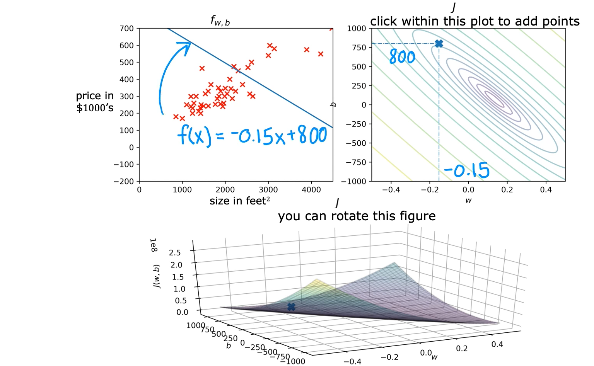
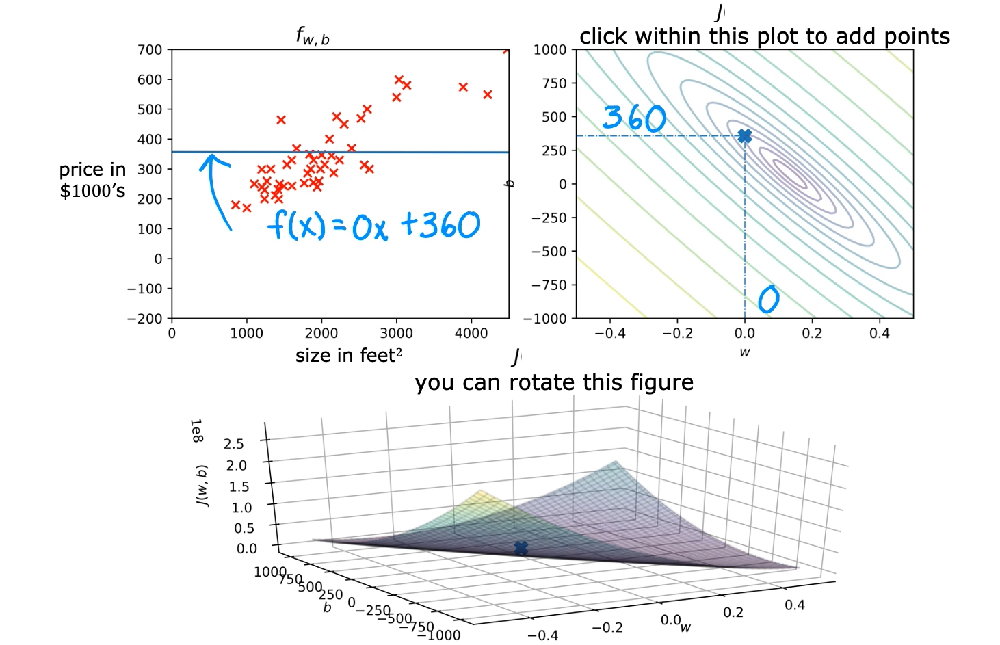
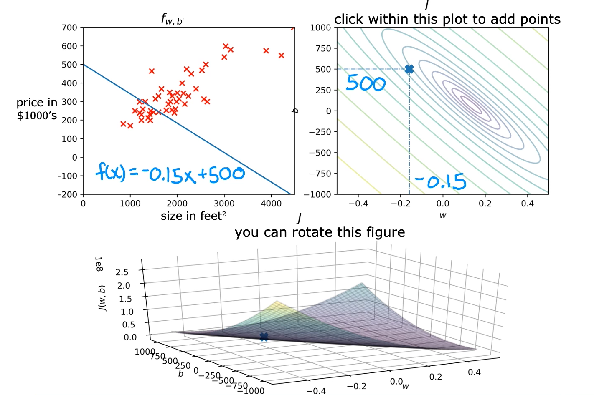
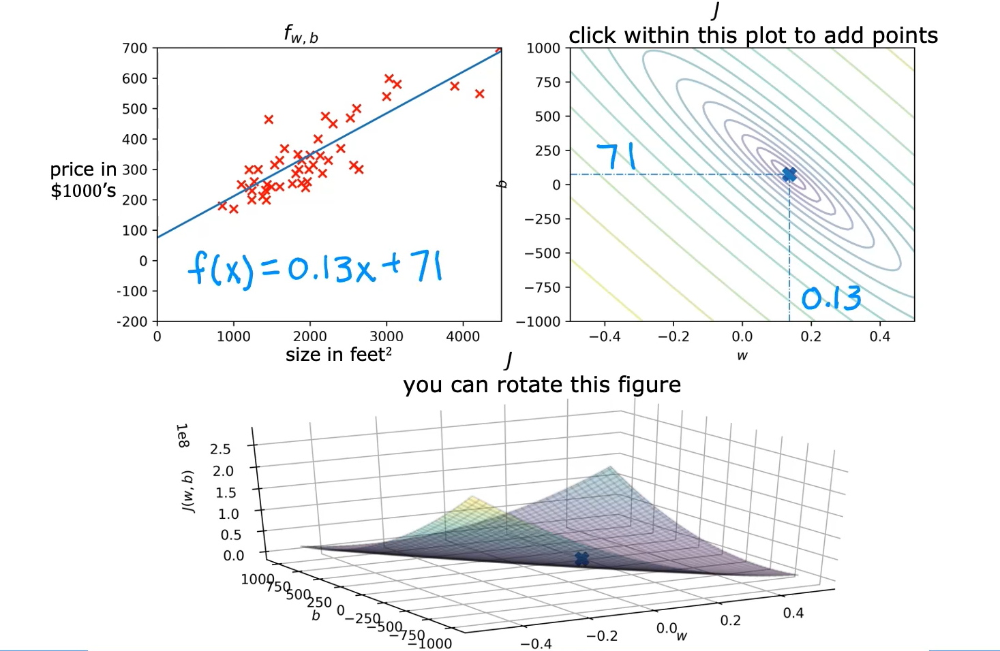

# Visualization Examples

This section demonstrates how different choices of the parameters `w` and `b` affect the linear regression model and its corresponding cost. By comparing prediction lines with their positions on the contour plot, we can understand how better-fitting models correspond to lower cost values.

## 1. Understanding Different Parameter Choices

Recall that the linear regression model is:

$$
f_{w,b}(x) = wx + b
$$

The parameters determine the characteristics of the prediction line:

- **w:** Determines the slope of the line.
- **b:** Determines the y-intercept of the line.

Every combination of `w` and `b` produces a particular prediction line and a corresponding cost value $J(w,b)$.

The contour plot helps visualize these cost values. The center of the smallest ellipse represents the minimum cost. Points farther away from this center generally correspond to higher costs.

## 2. Examples of Different Values of w and b

### Example 1: w = -0.15, b = 800

For this choice of parameters, the model becomes:

$$
f_{w,b}(x) = -0.15x + 800
$$

- The y-intercept is `800`.
- The slope is `-0.15`, so the line slopes downward.
- The prediction line does not fit the training data well.
- Many predicted values are considerably different from the actual target values.

On the contour plot, the corresponding point is relatively far from the minimum, indicating a high cost.

### Example 2: w = 0, b = 360

For this choice of parameters, the model becomes:

$$
f_{w,b}(x) = 0x + 360
$$

Simplifying:

$$
f_{w,b}(x) = 360
$$

- The slope is zero, so the prediction line is horizontal.
- The y-intercept is `360`.
- The line still does not fit the training data particularly well.

Its corresponding point on the contour plot is closer to the minimum than the previous example, indicating a lower cost.

### Example 3: w = -0.15, b = 500

For this choice of parameters, the model becomes:

$$
f_{w,b}(x) = -0.15x + 500
$$

- The y-intercept is `500`.
- The slope is `-0.15`, so the line slopes downward.
- The prediction line is still not a good fit for the training data.

Its corresponding point on the contour plot is farther from the minimum than the previous example, indicating a higher cost than Example 2.

### Example 4: w = 0.13, b = 71

For this choice of parameters, the model becomes:

$$
f_{w,b}(x) = 0.13x + 71
$$

This line provides a much better fit to the training data.

- The slope is `0.13`.
- The y-intercept is `71`.
- The predicted values are relatively close to the actual target values.

The vertical distances between the training examples and the prediction line represent the prediction errors. The sum of their squared errors is close to the minimum possible sum among all straight-line fits. Consequently, the corresponding cost is also close to its minimum.

On the contour plot, the corresponding point is very close to the center of the smallest ellipse. Therefore, this parameter choice produces a cost close to the minimum, although it is not exactly the minimum.

## 3. Relationship Between Model Fit and Cost

These examples demonstrate the relationship between the prediction line and its corresponding position on the cost function graph.

- A poor-fitting prediction line generally has larger prediction errors and corresponds to a higher cost.
- A better-fitting prediction line generally has smaller prediction errors and corresponds to a lower cost.
- The best-fitting linear model corresponds to the minimum possible cost for the given training set.

Therefore, choosing values of `w` and `b` that minimize the cost function produces the best-fitting linear model according to the squared-error cost function.

## 4. Key Takeaways

- Different combinations of `w` and `b` produce different prediction lines.
- Every prediction line corresponds to a particular cost value on the contour plot.
- Poor-fitting lines generally correspond to higher cost values.
- Better-fitting lines correspond to lower cost values and points closer to the minimum.
- The goal of linear regression is to find the values of `w` and `b` that minimize the cost function.
