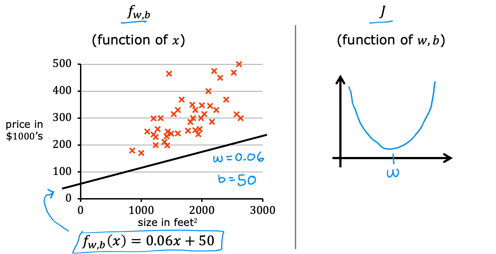
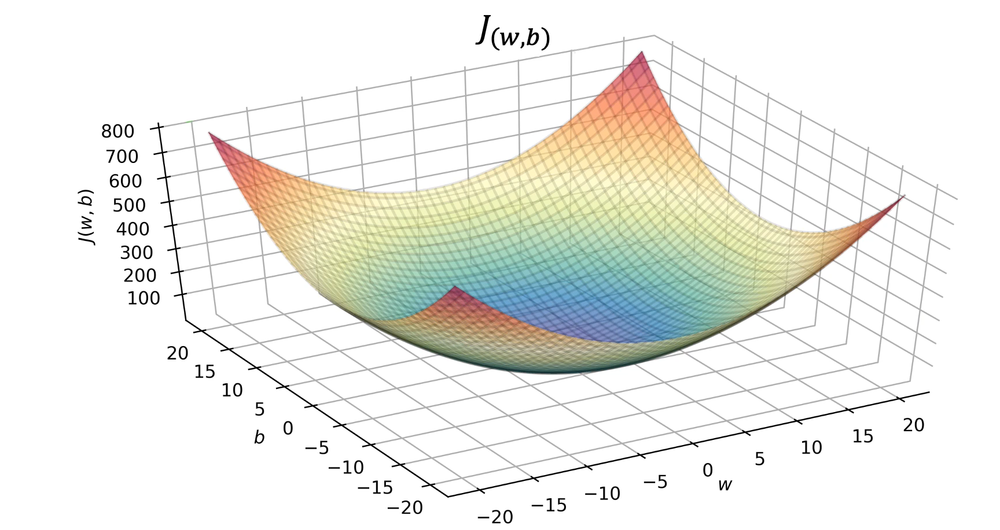
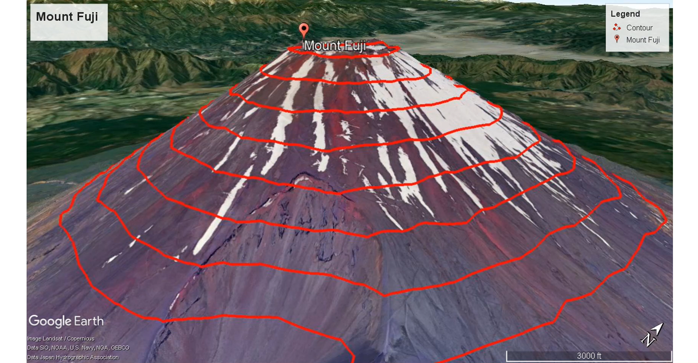
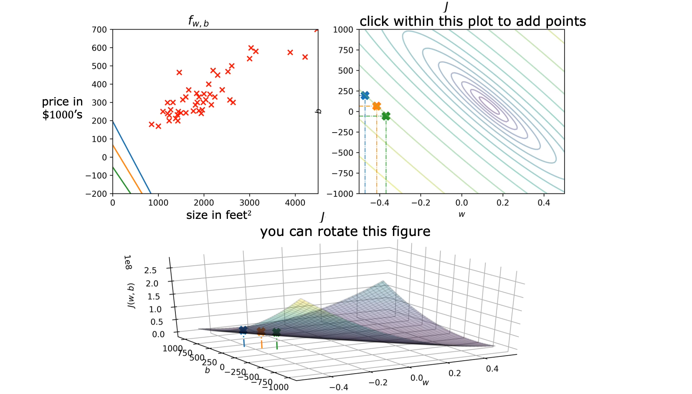
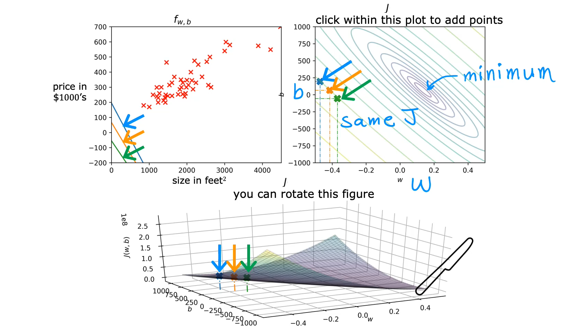

# Visualizing the Cost Function

The cost function for linear regression can be visualized using both model parameters, `w` and `b`. Three-dimensional surface plots and contour plots help illustrate how different parameter values correspond to different cost values.

## 1. Returning to the Full Linear Regression Model

The parameter `b` can be temporarily set to zero to simplify the visualization of the cost function. However, the full linear regression model uses both parameters:

$$
f_{w,b}(x) = wx + b
$$

The cost function is:

$$
J(w,b) = \frac{1}{2m}\sum_{i=1}^{m}(f_{w,b}(x^{(i)})-y^{(i)})^2
$$

The goal of linear regression is to find values of `w` and `b` that minimize the cost function:

$$
\underset{w,b}{\text{minimize}} \ J(w,b)
$$

Each combination of `w` and `b` produces a different prediction line and a corresponding cost value.

## 2. Understanding the 3D Surface Plot

Consider the housing price training set and a possible linear regression model with:

$$
w = 0.06, \quad b = 50
$$

The model becomes:

$$
f_{w,b}(x) = 0.06x + 50
$$

This is not a particularly good model because it consistently underestimates the housing prices.

When the cost function has only one parameter, `w`, its graph is a U-shaped curve resembling a soup bowl.

However, when the model has two parameters, `w` and `b`, the cost function becomes a three-dimensional surface with a similar bowl-like shape.

### Axes of the 3D Surface Plot

- **W-axis:** Represents the parameter `w`.
- **B-axis:** Represents the parameter `b`.
- **J-axis:** Represents the cost value `J(w,b)`.

As the values of `w` and `b` change, the cost function produces different values of `J(w,b)`.

Every point on the 3D surface represents a particular combination of `w` and `b`, and its height represents the corresponding cost.

For example, when:

$$
w = -10, \quad b = -15
$$

The height of the surface at that parameter combination represents:

$$
J(-10,-15)
$$

## 3. Contour Plot

Another way to visualize the same cost function is through a **contour plot**.

A contour plot represents the 3D cost function in two dimensions. It is similar to a topographical map that shows the heights of different locations on a mountain.

### Understanding Contour Lines

Imagine looking directly down at a mountain from above.

A topographical map contains contour lines that connect locations at the same height. Similarly, a contour plot of the cost function contains lines connecting points that have the same cost value.

The contour plot uses:

- **W-axis (horizontal):** Represents the parameter `w`.
- **B-axis (vertical):** Represents the parameter `b`.

Each oval or ellipse represents a set of parameter combinations that produce the same cost value.

In other words, every point along the same contour line has an identical value of $J(w,b)$, even though the individual values of `w` and `b` may be different.

## 4. Relationship Between 3D Surface and Contour Plots

A contour plot is created by taking horizontal slices of the 3D cost function surface.

Each horizontal slice intersects the surface at points having the same height. When viewed from above, these intersections appear as contour lines.

Therefore:

- The 3D surface plot shows the cost function as a three-dimensional shape.
- The contour plot shows the same cost function from a top-down perspective.
- Each contour line represents a constant cost value.
- Different contour lines represent different cost values.

### Understanding the Minimum Cost

The lowest point of the 3D surface represents the minimum value of the cost function.

In the contour plot, this minimum corresponds to the center of the concentric ovals, where the smallest oval is located.

The closer a contour line is to this center, the lower its corresponding cost value.

## 5. Key Takeaways

- The full linear regression model uses both parameters `w` and `b`.
- The cost function $J(w,b)$ depends on both model parameters.
- A 3D surface plot visualizes the cost function using `w`, `b`, and `J(w,b)` as its three axes.
- Every point on the 3D surface represents a particular combination of `w` and `b`, with its height representing the corresponding cost.
- A contour plot provides a two-dimensional, top-down representation of the same 3D cost function.
- Each contour line connects parameter combinations that have the same cost value.
- The minimum cost is represented by the lowest point of the 3D surface and the center of the concentric ovals in the contour plot.
- Both visualizations help understand how different parameter values affect the cost function and how linear regression seeks to minimize it.
