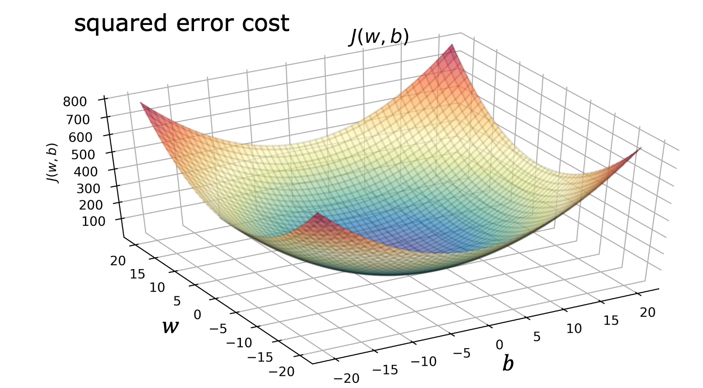

# Gradient Descent for Linear Regression

This section brings together the linear regression model, the squared error cost function, and the gradient descent algorithm. Combining them makes it possible to train the model so that a straight line fits the training data.

## 1. The Three Components

**Linear regression model:**

$$
f_{w,b}(x) = wx + b
$$

**Squared error cost function:**

$$
J(w,b) = \frac{1}{2m} \sum_{i=1}^{m} \left( f_{w,b}(x^{(i)}) - y^{(i)} \right)^2
$$

**Gradient descent** repeatedly updates the parameters $w$ and $b$ using the derivatives of the cost function in order to minimize $J(w,b)$.

## 2. Derivatives of the Cost Function

Calculating the derivatives of the squared error cost function yields the following expressions:

**Derivative with respect to $w$:**

$$
\frac{\partial}{\partial w} J(w,b) = \frac{1}{m} \sum_{i=1}^{m} \left( f_{w,b}(x^{(i)}) - y^{(i)} \right) x^{(i)}
$$

**Derivative with respect to $b$:**

$$
\frac{\partial}{\partial b} J(w,b) = \frac{1}{m} \sum_{i=1}^{m} \left( f_{w,b}(x^{(i)}) - y^{(i)} \right)
$$

These expressions are obtained using calculus. The factor of $\frac{1}{2}$ that was included in the cost function earlier cancels with the $2$ that appears when differentiating the squared term, producing cleaner formulas.

## 3. Gradient Descent Algorithm

The complete gradient descent algorithm for linear regression is:

Repeat until convergence:

$$
w = w - \alpha \frac{1}{m} \sum_{i=1}^{m} \left( f_{w,b}(x^{(i)}) - y^{(i)} \right) x^{(i)}
$$

$$
b = b - \alpha \frac{1}{m} \sum_{i=1}^{m} \left( f_{w,b}(x^{(i)}) - y^{(i)} \right)
$$

where

$$
f_{w,b}(x^{(i)}) = w x^{(i)} + b
$$

The parameters $w$ and $b$ must be updated **simultaneously** on every step.

## 4. Convexity of the Squared Error Cost Function

In general, gradient descent can converge to different local minima depending on the starting values of the parameters. This does not occur with the squared error cost function used for linear regression.

The squared error cost function has a bowl shape (sometimes described as a hammock shape). It contains only one global minimum and no other local minima.

A function with this property is called a **convex function**. Because the cost function is convex, gradient descent is guaranteed to converge to the global minimum, provided the learning rate is chosen appropriately.

## 5. Key Takeaways

- Gradient descent for linear regression uses the specific derivatives of the squared error cost function.
- The update rules are:

$$
w = w - \alpha \frac{1}{m} \sum_{i=1}^{m} \left( f_{w,b}(x^{(i)}) - y^{(i)} \right) x^{(i)}
$$

$$
b = b - \alpha \frac{1}{m} \sum_{i=1}^{m} \left( f_{w,b}(x^{(i)}) - y^{(i)} \right)
$$

- $w$ and $b$ must be updated simultaneously.
- The squared error cost function is convex (bowl-shaped) and has only one global minimum.
- Because the cost function is convex, gradient descent converges to the global minimum when the learning rate is chosen appropriately.
