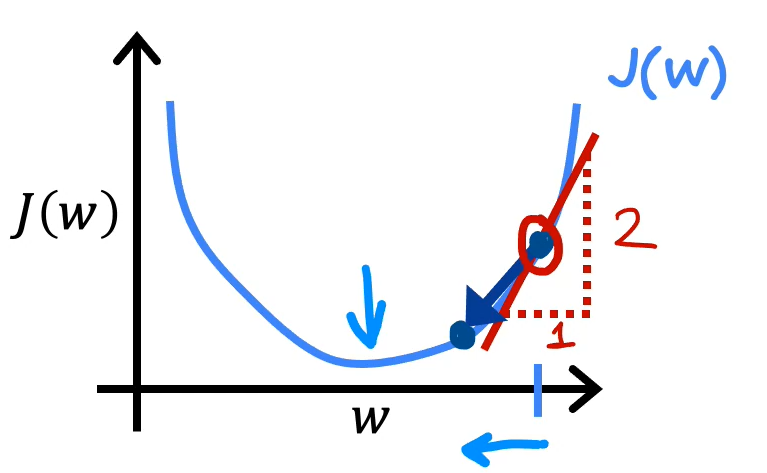
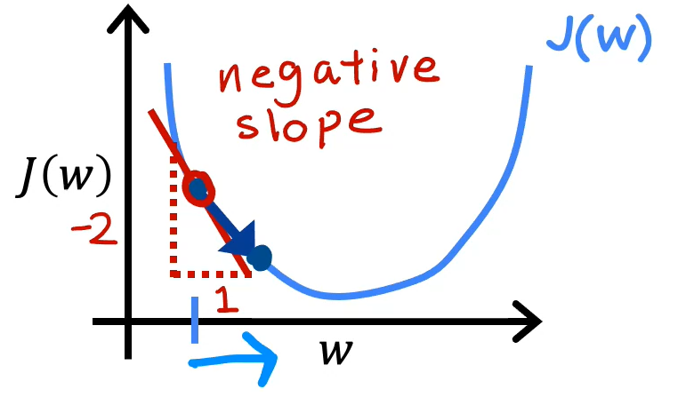

# Intuition Behind Gradient Descent

To better understand how gradient descent works, it helps to examine what the learning rate and the derivative term are doing, and why multiplying them together produces useful updates to the parameters.

Recall the gradient descent update rule:

$$
w = w - \alpha \frac{d}{dw} J(w)
$$

Here $\alpha$ is the learning rate, which controls the size of the step taken when updating the parameter. The derivative term determines the direction of the update.

To develop clearer intuition, consider a simpler case with only one parameter.

## 1. Simplifying to One Parameter

Instead of a cost function that depends on both $w$ and $b$, consider a cost function that depends on only one parameter:

$$
J(w)
$$

The goal is to minimize $J$ by adjusting the value of $w$.

The gradient descent update rule becomes:

$$
w = w - \alpha \frac{d}{dw} J(w)
$$

With only one parameter, the cost function can be visualized on a two-dimensional graph:

- The horizontal axis represents the parameter $w$.
- The vertical axis represents the cost $J(w)$.

## 2. Meaning of the Derivative

The derivative $\dfrac{d}{dw} J(w)$ at a particular point is the slope of the tangent line to the curve at that point.

A tangent line is a straight line that just touches the curve at one point.

The slope of this line can be found by drawing a small triangle and computing:

$$
\text{Slope} = \frac{\text{Height}}{\text{Width}}
$$

- When the tangent line slopes upward to the right, the derivative is **positive**.
- When the tangent line slopes downward to the right, the derivative is **negative**.

## 3. Case 1: Positive Derivative

Suppose gradient descent is initialized at a point on the right side of the cost function, where the tangent line slopes upward to the right.

At this point the derivative is positive (for example, $\dfrac{d}{dw} J(w) = 2$).

The update rule becomes:

$$
w = w - \alpha \times (\text{positive number})
$$

Since both $\alpha$ and the derivative are positive, a positive quantity is subtracted from $w$. As a result, $w$ decreases and the algorithm moves to the left on the graph — toward a lower value of the cost.

## 4. Case 2: Negative Derivative

Now suppose gradient descent is initialized at a point on the left side of the same cost function, where the tangent line slopes downward to the right.

At this point the derivative is negative (for example, $\dfrac{d}{dw} J(w) = -2$).

The update rule becomes:

$$
w = w - \alpha \times (\text{negative number})
$$

Subtracting a negative number is the same as adding a positive number. Therefore $w$ increases and the algorithm moves to the right on the graph — again toward a lower value of the cost.

## 5. Summary of the Derivative’s Role

| Derivative | Effect on $w$ | Direction of movement |
| ---------- | ------------- | --------------------- |
| Positive   | $w$ decreases | Left                  |
| Negative   | $w$ increases | Right                 |
| Zero       | $w$ unchanged | No movement           |

In both cases the derivative points gradient descent in the direction that reduces the cost. The learning rate $\alpha$ (which is always positive) simply scales the size of the step.

## 6. Key Takeaways

- Looking at a cost function of a single parameter $w$ makes the behavior of gradient descent easier to visualize.
- The derivative at a point is the slope of the tangent line at that point.
- A positive derivative causes $w$ to decrease (move left).
- A negative derivative causes $w$ to increase (move right).
- In both situations the update moves toward a lower value of the cost function.
- The learning rate $\alpha$ controls how large each step is, while the derivative determines the direction.
