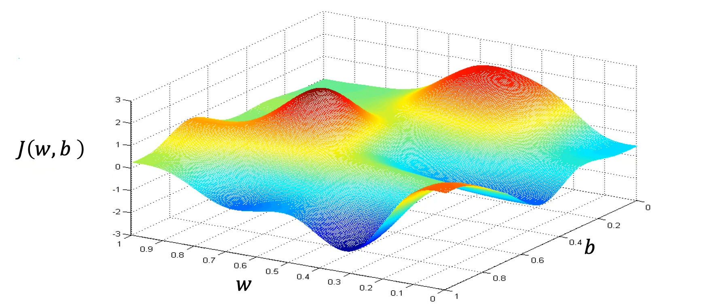
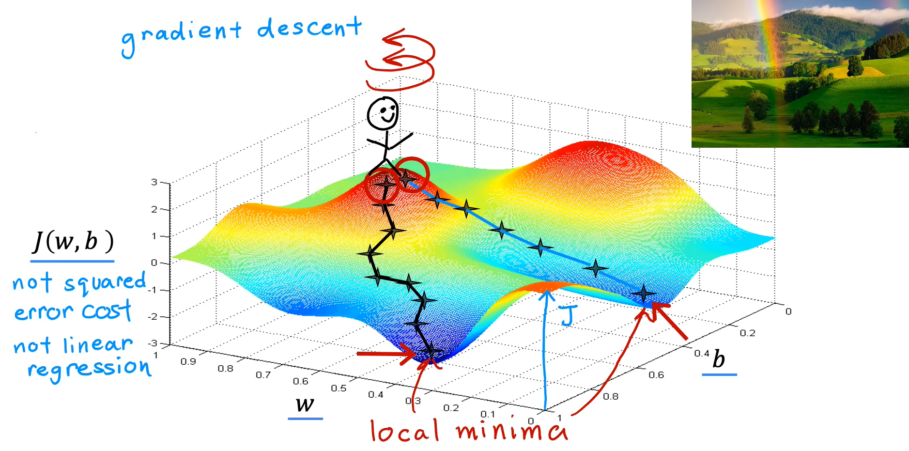

# Gradient Descent

Gradient descent is an algorithm used to systematically find the values of the parameters $w$ and $b$ that minimize a cost function $J(w, b)$.

Gradient descent is used widely in machine learning. It is not limited to linear regression. It is also used for training more advanced models, including neural network models (also called deep learning models). Understanding gradient descent provides one of the most important building blocks in machine learning.

## 1. Overview of Gradient Descent

The goal is to minimize a cost function $J(w, b)$.

Although the examples so far have used the cost function for linear regression, gradient descent is a more general algorithm. It can be used to minimize any function, not just the squared error cost function of linear regression.

Gradient descent also applies to cost functions that depend on more than two parameters. For example, given a cost function

$$
J(w_1, w_2, \dots, w_n, b)
$$

the objective is to minimize $J$ over the parameters $w_1$ through $w_n$ and $b$. In other words, the goal is to choose values for $w_1, \dots, w_n$ and $b$ that produce the smallest possible value of $J$.

## 2. How Gradient Descent Works

The process begins by choosing initial values for the parameters $w$ and $b$.

For linear regression, the choice of initial values does not matter too much. A common choice is to set both parameters to zero:

$$
w = 0, \quad b = 0
$$

Gradient descent then repeatedly updates the parameters $w$ and $b$ by a small amount in order to reduce the cost $J(w, b)$. This process continues until $J$ settles at or near a minimum.

## 3. Visual Intuition

For some cost functions that are not bowl-shaped or hammock-shaped, it is possible for there to be more than one minimum.

Consider a more complex surface plot of a cost function $J(w, b)$. This is not a squared error cost function. For linear regression with the squared error cost function, the surface is always bowl-shaped or hammock-shaped. The surface shown here is the type of cost function that can appear when training a neural network model.

The bottom axes represent the parameters $w$ and $b$. For different values of $w$ and $b$, different points on the surface are obtained. The height of the surface at any point is the value of the cost function $J(w, b)$.

Imagine this surface plot as a slightly hilly outdoor park or golf course, where the high points are hills and the low points are valleys.

Suppose you are standing at a point high up on the hill. The goal is to reach the bottom of one of the valleys as efficiently as possible.

Gradient descent works as follows:

- Look around in all directions.
- Identify the direction of **steepest descent** — the direction that leads downhill most quickly.
- Take a small step in that direction.
- From the new position, repeat the process: look around, choose the direction of steepest descent, and take another small step.

Continuing this process leads to the bottom of a valley. This bottom point is a **local minimum**.

## 4. Dependence on the Starting Point

Gradient descent has an interesting property related to the choice of starting point.

The starting point on the surface is determined by the initial values of the parameters $w$ and $b$.

- Starting from one particular point can lead into one valley (one local minimum).
- Starting from a nearby point (just a short distance away) can lead into a completely different valley (a different local minimum).

The bottoms of these valleys are called **local minima**.

- If the process starts in the first valley, gradient descent will not move to the second valley.
- If the process starts in the second valley, it will remain in that minimum and will not reach the first local minimum.

This dependence on the starting point is an important property of gradient descent.

## 5. Key Takeaways

- Gradient descent is a systematic algorithm for finding parameter values that minimize a cost function $J(w, b)$.
- It is a general algorithm that can be applied to many different cost functions, not only the squared error cost of linear regression.
- The algorithm starts with initial parameter values (commonly $w = 0$, $b = 0$ for linear regression) and repeatedly takes small steps to reduce the cost.
- At each step, the direction chosen is the direction of steepest descent.
- On complex cost surfaces with multiple valleys, the particular local minimum reached depends on the starting point.
