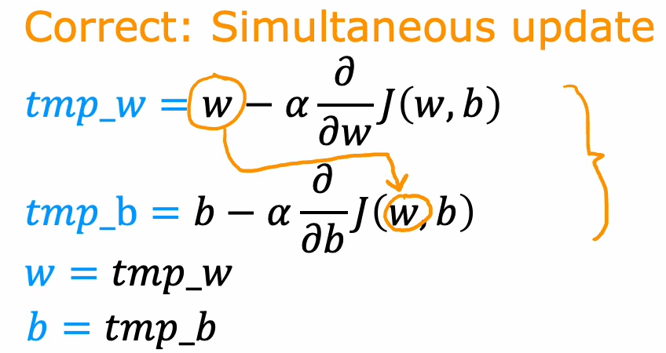
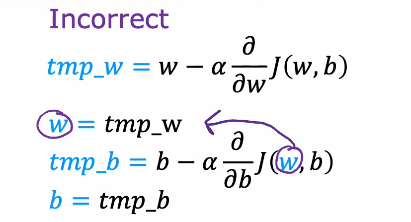

# Implementing Gradient Descent

Gradient descent is implemented by repeatedly updating the parameters $w$ and $b$ using the following rules until the algorithm converges:

$$
w = w - \alpha \frac{\partial}{\partial w} J(w, b)
$$

$$
b = b - \alpha \frac{\partial}{\partial b} J(w, b)
$$

These update steps are repeated until the parameters no longer change significantly, at which point the cost function $J(w, b)$ has reached (or is very close to) a local minimum.

## 1. Understanding the Update Equations

In the update equations above, the equal sign represents an **assignment** operation. It means: take the value on the right-hand side and store it as the new value of the parameter on the left-hand side.

This is different from a mathematical statement of equality. For example, writing $a = a + 1$ is a valid assignment that increments the value of $a$, even though the mathematical statement “$a$ equals $a + 1$” can never be true.

In Python and other programming languages, the double equal sign (`==`) is used to test whether two values are equal.

However, in mathematical notation, the equal sign can represent either an assignment or a statement of equality, depending on the context.

## 2. The Learning Rate $\alpha$

The symbol $\alpha$ (alpha) is called the **learning rate**.

- It is a small positive number, typically between 0 and 1 (for example, $0.01$).
- It controls the size of the step taken on each iteration of gradient descent.
- A large learning rate leads to large, aggressive steps downhill.
- A small learning rate leads to small, cautious steps downhill.

Choosing an appropriate value for $\alpha$ is important for the algorithm to work effectively.

## 3. The Derivative Term

The term $\dfrac{\partial}{\partial w} J(w, b)$ (and the corresponding term for $b$) is the **partial derivative** of the cost function with respect to the parameter being updated.

This derivative tells the algorithm:

- the direction in which the cost function is increasing most steeply, and
- together with the learning rate, how large a step to take downhill.

Even without a background in calculus, it is possible to understand and implement gradient descent by treating these derivative terms as quantities that indicate the direction and relative size of the needed update.

## 4. Simultaneous Update of Parameters

A critical detail in the correct implementation of gradient descent is that the parameters $w$ and $b$ must be updated **simultaneously**.

This means calculating the new values of both parameters using their original values before updating either one.

### Correct Implementation (Simultaneous Update)

1. Compute the new value for $w$ using the **current** values of $w$ and $b$, and store it in a temporary variable:

   $$
   \text{temp}_w = w - \alpha \frac{\partial}{\partial w} J(w, b)
   $$

2. Compute the new value for $b$ using the **same current** values of $w$ and $b$, and store it in another temporary variable:

   $$
   \text{temp}_b = b - \alpha \frac{\partial}{\partial b} J(w, b)
   $$

3. Only after both temporary values have been calculated, assign them back to the parameters:

   $$
   w = \text{temp}_w
   $$

   $$
   b = \text{temp}_b
   $$

Both updates use the original, pre-update values of $w$ and $b$, ensuring that neither update affects the calculation of the other.

### Incorrect Implementation (Non-simultaneous Update)

An incorrect approach would be to update $w$ first and then immediately use the newly updated value of $w$ when computing the update for $b$. This changes the meaning of the algorithm and produces different results.

In this approach:

1. The new value of $w$ is calculated and assigned immediately.
2. The new value of $b$ is then calculated using the already updated value of $w$.
3. As a result, the calculation of the update for $b$ differs from the one performed in the correct simultaneous implementation.

Although non-simultaneous updates may still work more or less, they effectively produce a different algorithm with different properties.

When people refer to gradient descent, they always mean the version that performs a simultaneous update of all parameters. Therefore, the simultaneous update approach should always be used when implementing gradient descent.

## 5. Convergence

The algorithm is said to have **converged** when the parameters $w$ and $b$ stop changing significantly with additional iterations.

At this point, the process has reached (or is very close to) a local minimum of the cost function.

## 6. Key Takeaways

- Gradient descent repeatedly applies the update rules:

  $$
  w := w - \alpha \frac{\partial J}{\partial w}
  $$

  $$
  b := b - \alpha \frac{\partial J}{\partial b}
  $$

  until convergence.

- The learning rate $\alpha$ controls the size of each step.
- The derivative terms determine the direction and, together with the learning rate, the size of each update.
- The equal sign can represent an assignment operation or a mathematical statement of equality, depending on the context.
- Parameters must be updated **simultaneously** using temporary variables and their original values.
- Non-simultaneous updates produce a different algorithm.
- Simultaneous update is the standard and correct way to implement gradient descent.
