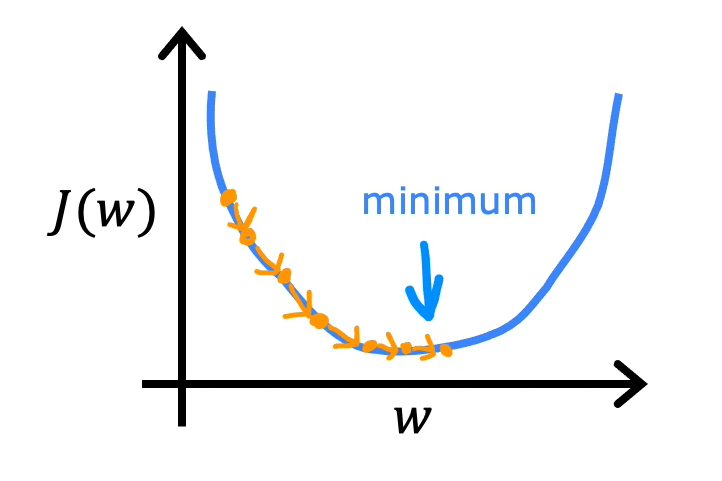
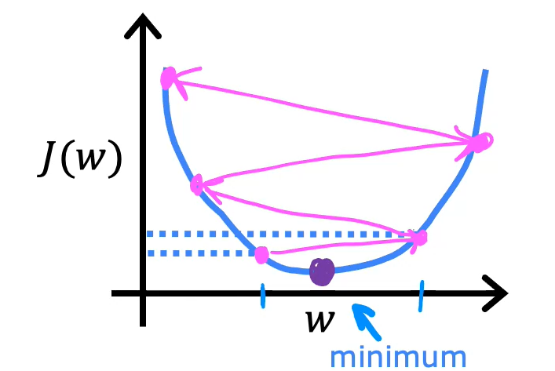
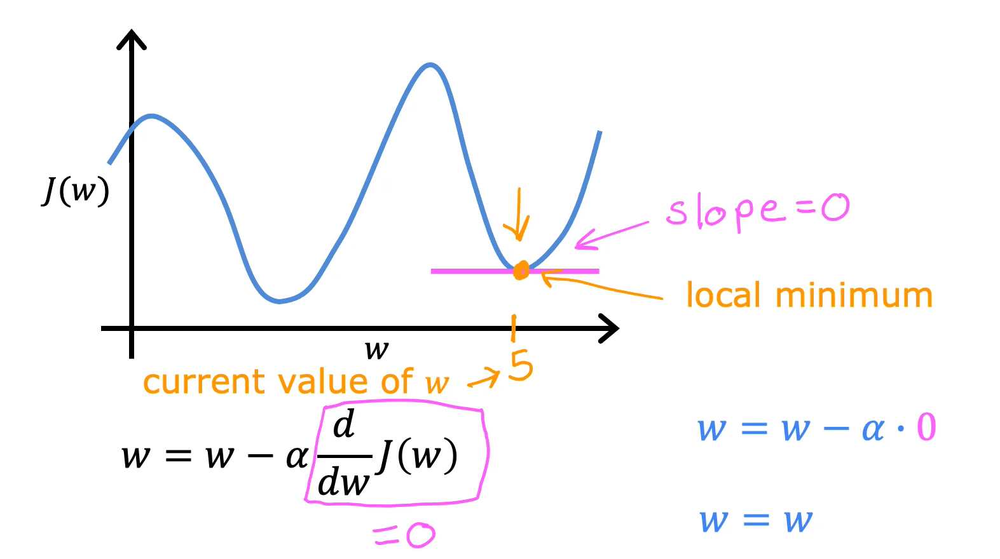
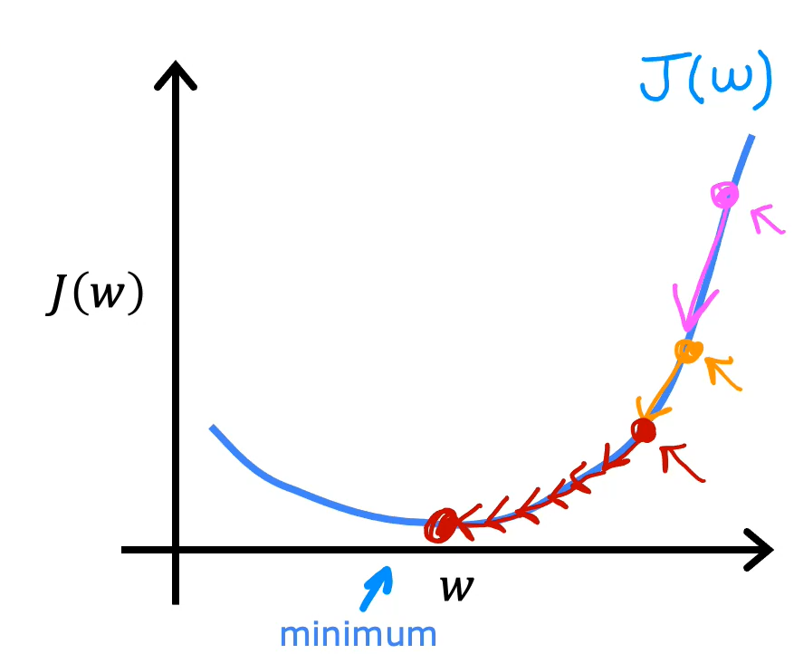

# Learning Rate

The choice of the learning rate $\alpha$ has a large impact on how well gradient descent works. If $\alpha$ is chosen poorly, the algorithm may become very slow or may fail to reach a minimum at all.

Recall the gradient descent update rule:

$$
w = w - \alpha \frac{d}{dw} J(w)
$$

## 1. Learning Rate Too Small

When the learning rate is too small, each update multiplies the derivative by a very small number. As a result, the algorithm takes only tiny steps.

Even though the cost $J$ does decrease, progress is extremely slow. Many steps are required before the parameter gets close to the minimum.

**Summary:**  
If $\alpha$ is too small, gradient descent still works, but it converges very slowly.

## 2. Learning Rate Too Large

When the learning rate is too large, the algorithm takes oversized steps.

Starting from a point near the minimum, a large step can overshoot the minimum and land at a point where the cost is higher. From there, another large step may overshoot again in the opposite direction. Continuing this process can cause the parameter to move farther and farther away from the minimum.

**Summary:**  
If $\alpha$ is too large, gradient descent may overshoot the minimum, fail to converge, or even diverge.

## 3. What Happens at a Local Minimum

Suppose the current value of $w$ is already at a local minimum of the cost function.

At that point the slope of the tangent line is zero, so the derivative is zero:

$$
\frac{d}{dw} J(w) = 0
$$

The update rule then becomes:

$$
w = w - \alpha \cdot 0 = w
$$

The parameter does not change. Once gradient descent has reached a local minimum, further updates leave the parameter unchanged, which is the desired behavior.

## 4. Automatic Reduction of Step Size

Even when the learning rate $\alpha$ is kept fixed, the size of the steps taken by gradient descent becomes smaller as the algorithm approaches a minimum.

This happens because the derivative itself becomes smaller near the minimum:

- Far from the minimum the slope is steep, so the steps are relatively large.
- Closer to the minimum the slope is gentler, so the steps become smaller.
- At the minimum the slope is zero and the steps stop.

This automatic reduction in step size allows gradient descent to settle at a local minimum even with a constant learning rate.

## 5. Key Takeaways

- A learning rate that is too small makes gradient descent slow.
- A learning rate that is too large can cause overshooting, non-convergence, or divergence.
- At a local minimum the derivative is zero, so the parameter stops changing.
- As the algorithm approaches a minimum, the derivative becomes smaller and the steps automatically become smaller, even if $\alpha$ is fixed.
- Gradient descent can be applied to minimize many different cost functions, not only the squared-error cost used for linear regression.
