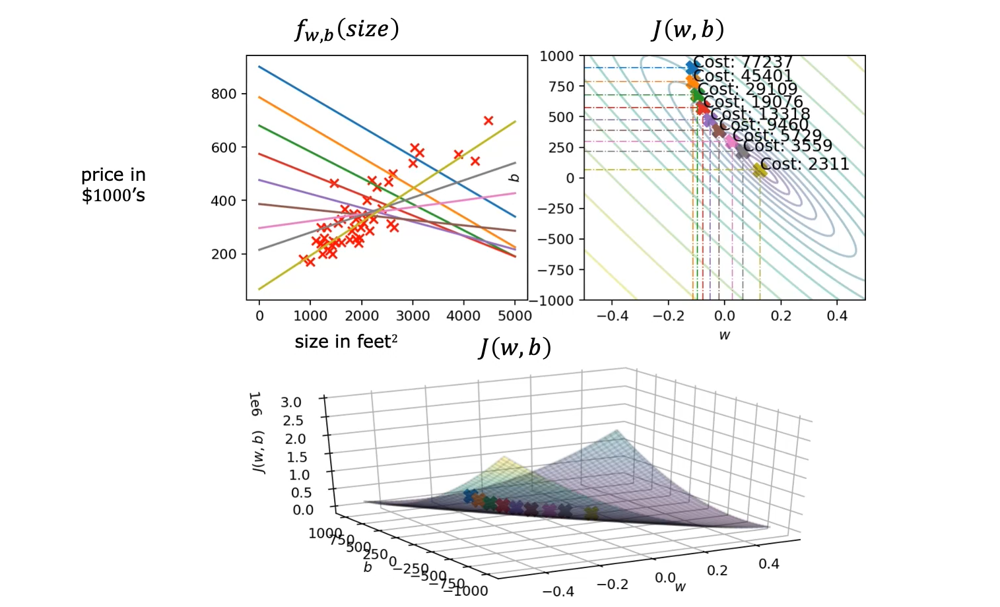

# Running Gradient Descent

This section shows what happens when gradient descent is applied to linear regression and how the parameters and the fitted line improve over successive steps.

## 1. Visualizing the Process

Gradient descent can be visualized using three related plots:

- A plot of the model (the straight line) together with the training data
- A contour plot of the cost function $J(w,b)$
- A surface plot of the same cost function

These views make it possible to watch both the parameters and the fitted line change as the algorithm runs.

## 2. Starting Point and Updates

The parameters are often initialized to zero. For demonstration purposes they can also be started at other values (for example, $w = -0.1$ and $b = 900$).

Each step of gradient descent moves the parameters to a new point on the cost function surface. As the steps continue:

- The cost $J(w,b)$ decreases
- The parameters $w$ and $b$ follow a trajectory toward the minimum
- The straight-line fit to the data improves

After enough steps the algorithm reaches the global minimum of the cost function. The corresponding values of $w$ and $b$ produce a straight line that fits the training data well.

## 3. Making Predictions

Once the parameters have been found, the trained model

$$
f_{w,b}(x) = wx + b
$$

can be used to make predictions. For a new input (for example, a house of size 1250 square feet) the model produces an estimated output (price).

## 4. Batch Gradient Descent

The version of gradient descent used here is called **batch gradient descent**.

In batch gradient descent, every update uses the entire training set. When the derivatives are computed, the sum runs over all $m$ training examples:

$$
\sum_{i=1}^{m}
$$

The name “batch” refers to the fact that the algorithm looks at the full batch of training examples on every step.

Other variants of gradient descent exist that use only a subset of the data on each update, but batch gradient descent is the method applied to linear regression in this setting.

## 5. Key Takeaways

- Running gradient descent on linear regression produces a sequence of improving straight-line fits to the data.
- The cost decreases with each step until the global minimum is reached.
- The trained model can then be used to make predictions on new inputs.
- The algorithm that uses the entire training set on every update is called **batch gradient descent**.
