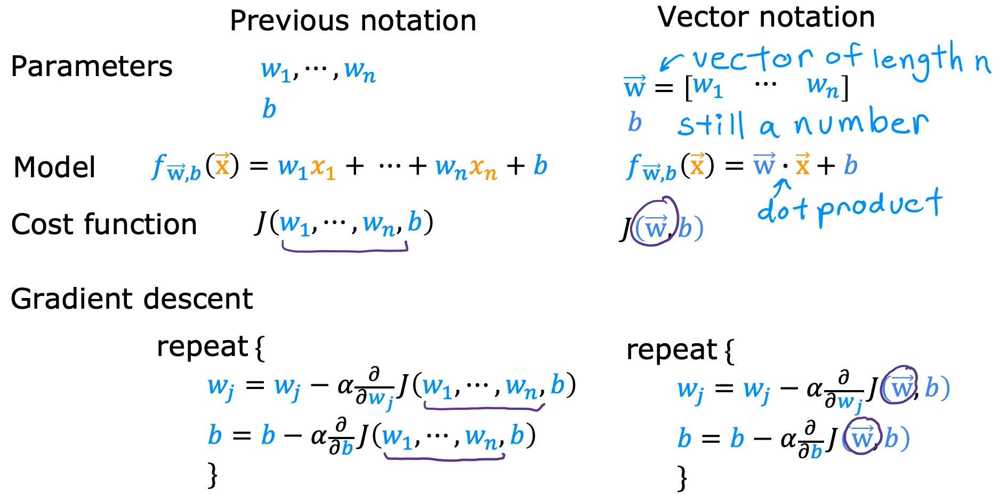
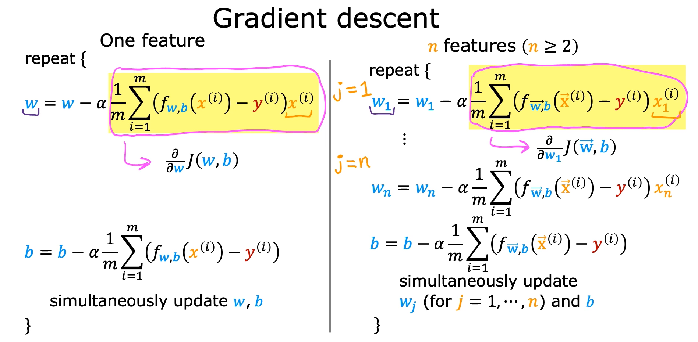

# Gradient Descent for Multiple Regression

Multiple linear regression uses two or more input features ($n \ge 2$) to make predictions. By combining gradient descent with vector notation, the model parameters can be represented compactly and updated efficiently using vectorized operations.

## 1. Multiple Linear Regression in Vector Form

In multiple linear regression, the model has parameters $w_1, w_2, \dots, w_n$ and $b$, where $n$ is the number of input features.

Instead of treating each weight as a separate number, all weights can be collected into a single parameter vector $\vec{w}$ of length $n$. The input features are also represented as a vector $\vec{x}$ of length $n$, while $b$ remains a single number (scalar).

Using vector notation, the multiple linear regression model is written succinctly as:

$$
f_{\vec{w},b}(\vec{x}) = \vec{w} \cdot \vec{x} + b
$$

Here, $\vec{w} \cdot \vec{x}$ represents the dot product of the weight vector and the input feature vector.

Similarly, instead of writing the cost function $J$ as a function of $n$ separate weights $w_1, \dots, w_n$ and $b$, it is written as a function of the parameter vector $\vec{w}$ and scalar $b$:

$$
J(\vec{w}, b)
$$

The cost function takes $\vec{w}$ and $b$ as inputs and returns a single number representing the cost.

## 2. Gradient Descent with One Feature vs Multiple Features

Gradient descent repeatedly updates the model parameters to minimize the cost function $J(\vec{w}, b)$.

For linear regression with one feature ($n = 1$), there are two parameters, $w$ and $b$, with the following update rules:

$$
w = w - \alpha \frac{\partial}{\partial w} J(w,b)
$$

$$
b = b - \alpha \frac{\partial}{\partial b} J(w,b)
$$

Here, $\alpha$ is the learning rate, and the derivative terms represent the partial derivatives of the cost function with respect to each parameter.

When moving from one feature to multiple features ($n \ge 2$), the single weight $w$ becomes $n$ separate weights: $w_1, w_2, \dots, w_n$. Each weight $w_j$ is updated using its corresponding partial derivative:

$$
w_j = w_j - \alpha \frac{\partial}{\partial w_j} J(\vec{w},b) \quad \text{for } j = 1, \dots, n
$$

The update rule for $b$ keeps the same form:

$$
b = b - \alpha \frac{\partial}{\partial b} J(\vec{w},b)
$$

### 2.1 Partial Derivatives for Multiple Features

For one feature, the single input feature for the $i$-th training example is written as $x^{(i)}$, and the partial derivative of the cost function with respect to $w$ is:

$$
\frac{\partial}{\partial w} J(w,b) = \frac{1}{m} \sum_{i=1}^{m} \left( f_{w,b}(x^{(i)}) - y^{(i)} \right) x^{(i)}
$$

For multiple features, the partial derivative with respect to each weight $w_j$ (for $j = 1, \dots, n$) becomes:

$$
\frac{\partial}{\partial w_j} J(\vec{w},b) = \frac{1}{m} \sum_{i=1}^{m} \left( f_{\vec{w},b}(\vec{x}^{(i)}) - y^{(i)} \right) x_j^{(i)}
$$

The structure of the derivative remains very similar to the single-feature case:

- The error term still measures the difference between the model's prediction $f_{\vec{w},b}(\vec{x}^{(i)})$ and the actual target value $y^{(i)}$.
- The parameters and inputs are now vectors ($\vec{w}$ and $\vec{x}^{(i)}$).
- Instead of multiplying by $x^{(i)}$, each derivative multiplies by $x_j^{(i)}$, which selects the $j$-th feature of the $i$-th training example (for example, $x_1^{(i)}$ when updating $w_1$).

The partial derivative with respect to $b$ is:

$$
\frac{\partial}{\partial b} J(\vec{w},b) = \frac{1}{m} \sum_{i=1}^{m} \left( f_{\vec{w},b}(\vec{x}^{(i)}) - y^{(i)} \right)
$$

All parameters ($w_1, \dots, w_n$ and $b$) must be updated simultaneously on each iteration, using the parameter values from the start of the iteration rather than newly updated values.

## 3. Vectorized Form of the Updates

Because the weights are grouped into a vector $\vec{w}$, the individual weight updates for $j = 1, \dots, n$ can be combined into a single vectorized update:

$$
\vec{w} = \vec{w} - \alpha \frac{1}{m} \sum_{i=1}^{m} \left( f_{\vec{w},b}(\vec{x}^{(i)}) - y^{(i)} \right) \vec{x}^{(i)}
$$

The update for the scalar $b$ remains:

$$
b = b - \alpha \frac{1}{m} \sum_{i=1}^{m} \left( f_{\vec{w},b}(\vec{x}^{(i)}) - y^{(i)} \right)
$$

This vector formulation expresses all weight updates in one equation and enables fast, efficient implementation using numerical libraries such as NumPy.

## 4. The Normal Equation

The **normal equation** is an alternative method for finding the parameters $\vec{w}$ and $b$ in linear regression.

Unlike gradient descent, which minimizes the cost function iteratively over many steps, the normal equation uses advanced linear algebra techniques to solve for $\vec{w}$ and $b$ directly in one step without iterations.

### 4.1 Limitations of the Normal Equation

While useful in specific contexts, the normal equation has two major disadvantages:

- **Limited to Linear Regression:** Unlike gradient descent, it does not generalize to other learning algorithms such as logistic regression or neural networks.
- **Computationally Expensive with Many Features:** It becomes very slow when the number of features $n$ is large.

In practice, machine learning practitioners rarely implement the normal equation themselves. However, mature machine learning libraries may use it behind the scenes when solving standard linear regression problems. For implementing linear regression and training almost any other machine learning algorithm, gradient descent is generally the better approach.

## 5. Key Takeaways

- Multiple linear regression ($n \ge 2$ features) is one of the most widely used machine learning algorithms in practice.
- Collecting weights $w_1, \dots, w_n$ into a vector $\vec{w}$ allows the model and cost function to be written compactly as $f_{\vec{w},b}(\vec{x}) = \vec{w} \cdot \vec{x} + b$ and $J(\vec{w}, b)$.
- With multiple features, gradient descent updates each weight $w_j$ (for $j = 1, \dots, n$) using its corresponding feature value $x_j^{(i)}$ in the partial derivative.
- All parameters ($\vec{w}$ and $b$) must be updated simultaneously during each iteration.
- Vectorization combines the individual weight updates into a single vector operation, making code implementation cleaner and faster.
- The normal equation solves for linear regression parameters in a single step without iterations, but it is slow for large feature sets and does not generalize to other machine learning algorithms.
- Gradient descent remains the preferred, general-purpose optimization method for linear regression and beyond.
