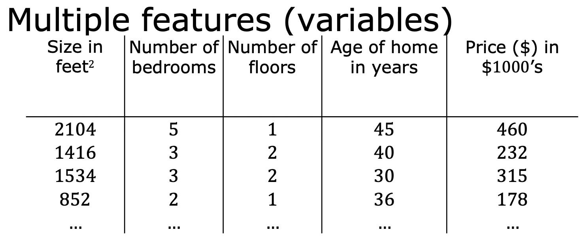
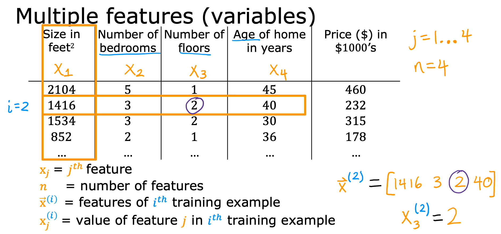
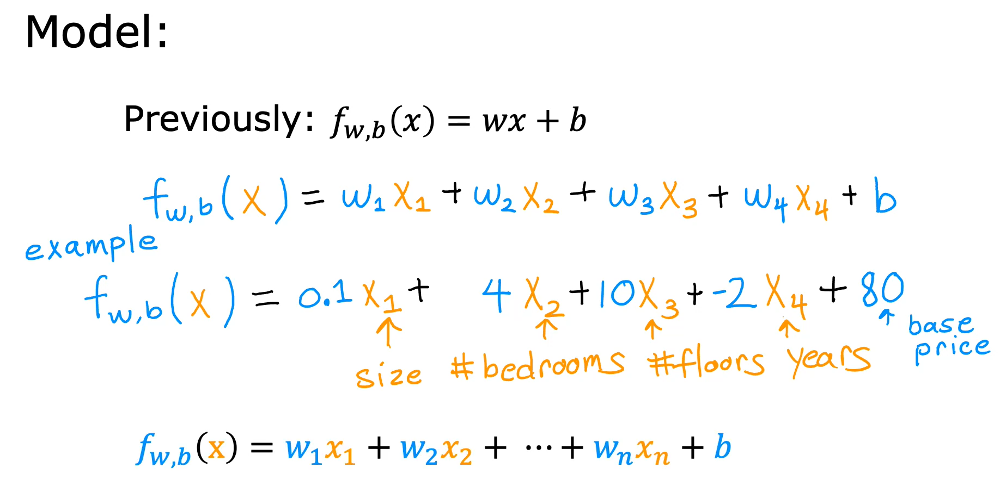
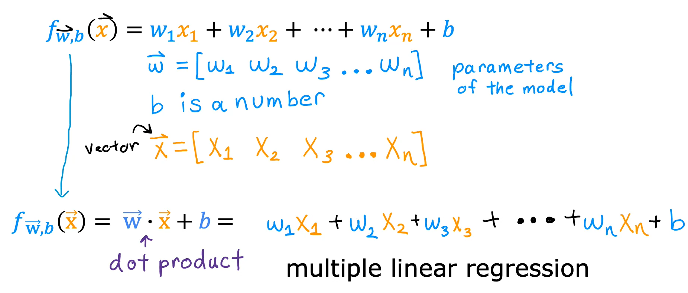

# Multiple Features

Linear regression can be extended to use multiple input features instead of just one. This makes the model more powerful because it can use additional information to make better predictions.

## 1. From One Feature to Multiple Features

In the original version of linear regression, the model used a single feature $x$ (for example, the size of a house) to predict the target $y$ (the price of the house):

$$
f_{w,b}(x) = wx + b
$$

With multiple features available (such as the size of the house, the number of bedrooms, the number of floors, and the age of the house), the model can make use of all of this information.

## 2. Notation for Multiple Features

The features are represented as:

$$
x_1, x_2, x_3, x_4
$$

- $x_j$ (or $x$ sub $j$) refers to the $j$-th feature.
- $n$ is the total number of features. In this example, $n = 4$.

As before, $x^{(i)}$ denotes the $i$-th training example. With multiple features, $x^{(i)}$ is a list of numbers (a **vector**) that includes all the features of the $i$-th training example.

**Example:**  
$x^{(2)}$ is the feature vector for the second training example. It might look like:

$$
x^{(2)} = [1416,\ 3,\ 2,\ 40]
$$

To refer to a specific feature in a specific training example, the notation $x^{(i)}_j$ is used.  
For example, $x^{(2)}_3$ is the value of the third feature (number of floors) in the second training example.

Sometimes an arrow is drawn on top of a symbol (for example, $\vec{x}^{(2)}$) to emphasize that it is a vector (a list of numbers) rather than a single number. This arrow is optional and is only used as a visual reminder.

## 3. The Model with Multiple Features

With multiple features, the model becomes:

$$
f_{\mathbf{w},b}(\mathbf{x}) = w_1 x_1 + w_2 x_2 + w_3 x_3 + w_4 x_4 + b
$$

**Example** (housing price prediction, with price in thousands of dollars):

$$
f(\mathbf{x}) = 0.1 x_1 + 4 x_2 + 10 x_3 - 2 x_4 + 80
$$

Interpretation of the parameters:

- $b = 80$ → base price of about $\$80{,}000$
- $0.1$ → each additional square foot increases the price by $\$100$
- $4$ → each additional bedroom increases the price by $\$4{,}000$
- $10$ → each additional floor increases the price by $\$10{,}000$
- $-2$ → each additional year of age decreases the price by $\$2{,}000$

In general, when there are $n$ features, the model is:

$$
f_{\mathbf{w},b}(\mathbf{x}) = w_1 x_1 + w_2 x_2 + \dots + w_n x_n + b
$$

## 4. Vector Notation

The parameters $w_1, w_2, \dots, w_n$ can be grouped into a vector:

$$
\mathbf{w} = [w_1,\ w_2,\ \dots,\ w_n]
$$

An arrow is sometimes drawn on top ($\vec{w}$) to emphasize that this is a vector. The arrow is optional.

The features of an example can also be written as a vector:

$$
\mathbf{x} = [x_1,\ x_2,\ \dots,\ x_n]
$$

$b$ remains a single number (not a vector). The vector $\mathbf{w}$ together with the number $b$ are the parameters of the model.

Using this notation, the model can be rewritten more compactly with the **dot product**:

$$
f_{\mathbf{w},b}(\mathbf{x}) = \mathbf{w} \cdot \mathbf{x} + b
$$

The dot product of two vectors is computed by multiplying corresponding pairs of numbers and then summing the results:

$$
\mathbf{w} \cdot \mathbf{x} = w_1 x_1 + w_2 x_2 + \dots + w_n x_n
$$

This gives exactly the same expression as the expanded form of the model.

## 5. Multiple Linear Regression

The version of linear regression that uses multiple input features is called **multiple linear regression**.

This is in contrast to univariate linear regression, which uses only a single feature.

(Note: This is not the same as “multivariate regression,” which refers to something different.)

## 6. Key Takeaways

- Multiple features allow the model to use more information when making predictions.
- $x^{(i)}$ is a vector containing all features of the $i$-th training example.
- $x^{(i)}_j$ is the $j$-th feature of the $i$-th training example.
- An arrow on top of a symbol (optional) is sometimes used to emphasize that the symbol represents a vector.
- The model with $n$ features is:

$$
f_{\mathbf{w},b}(\mathbf{x}) = w_1 x_1 + w_2 x_2 + \dots + w_n x_n + b
$$

- This can be written more compactly using the dot product:

$$
f_{\mathbf{w},b}(\mathbf{x}) = \mathbf{w} \cdot \mathbf{x} + b
$$

- This form of the algorithm is called **multiple linear regression**.
