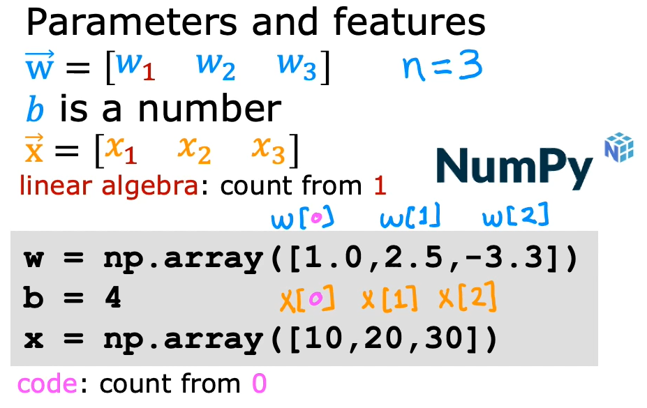
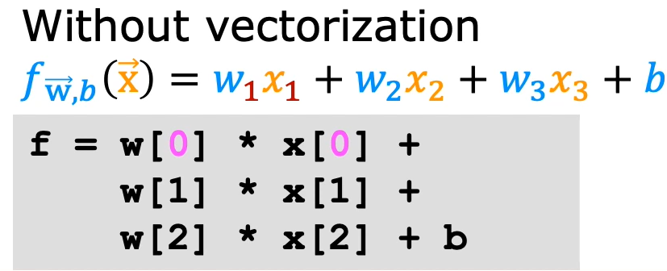
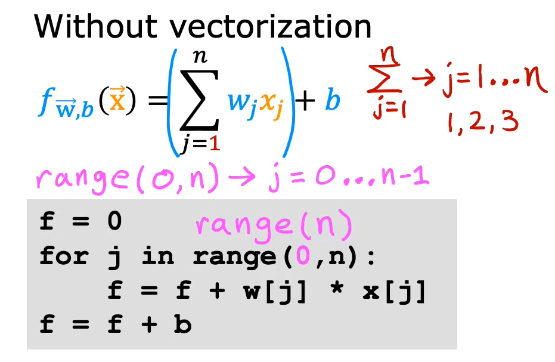
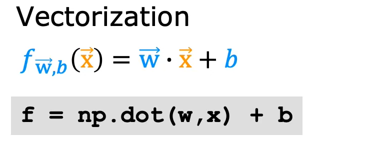
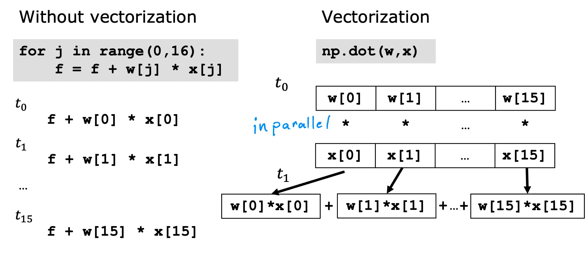
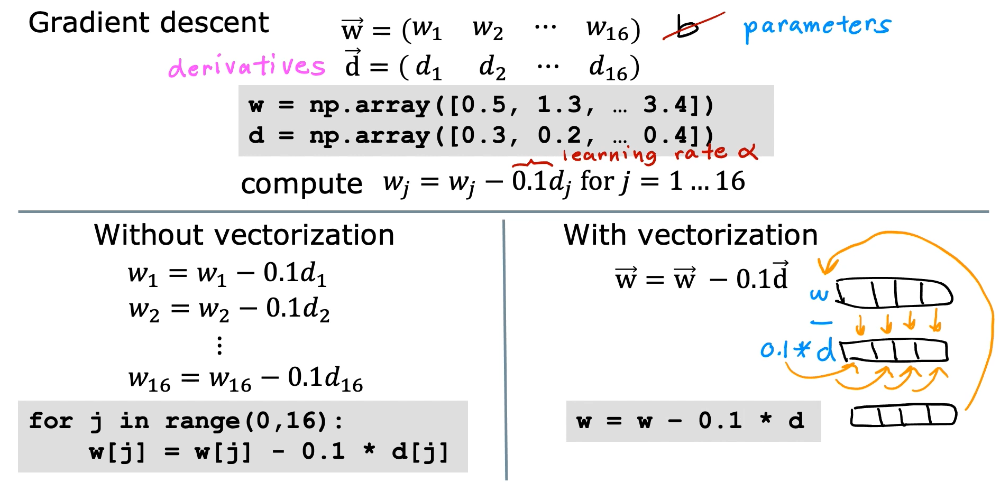

# Vectorization

Vectorization is a technique that makes code shorter and significantly more efficient when implementing machine learning algorithms. It allows algorithms to take advantage of modern numerical linear algebra libraries and specialized hardware, such as CPUs (Central Processing Units) and GPUs (Graphics Processing Units).

A GPU was originally designed to accelerate computer graphics, but it can also be used to perform computations in machine learning efficiently. By writing vectorized code, we can take advantage of optimized numerical operations and available parallel processing hardware.

## 1. Example Setup

Consider a linear regression model with parameters $\mathbf{w}$ and $b$, where $\mathbf{w}$ is a vector containing three numbers, and a feature vector $\mathbf{x}$ that also contains three numbers.

In this example, the number of features is:

$$
n = 3
$$

The parameter vector and feature vector can be represented as:

$$
\mathbf{w} =
\begin{bmatrix}
w_1 \\
w_2 \\
w_3
\end{bmatrix}
\qquad
\mathbf{x} =
\begin{bmatrix}
x_1 \\
x_2 \\
x_3
\end{bmatrix}
$$

In linear algebra, indexing usually starts from 1, so the individual values are written as $w_1, w_2, w_3$ and $x_1, x_2, x_3$.

In Python, we can define these vectors using arrays from a numerical linear algebra library called **NumPy**. NumPy is one of the most widely used numerical computing libraries in Python and is commonly used in machine learning.

Unlike mathematical indexing, Python array indexing starts from 0. Therefore, the individual elements are accessed as:

- `w[0]`, `w[1]`, `w[2]`
- `x[0]`, `x[1]`, `x[2]`

The first element is accessed using index `0`, the second using index `1`, and the third using index `2`.



This difference between mathematical indexing and Python indexing is important when translating mathematical expressions into code.

## 2. Implementation Without Vectorization

Before looking at vectorized implementations, let's consider how the model's prediction can be calculated without vectorization.

For a model with multiple input features, the prediction is calculated by multiplying each parameter in $\mathbf{w}$ by its corresponding feature in $\mathbf{x}$, adding all the products together, and finally adding the bias parameter $b$.

### Explicit Calculation

For three features, the prediction can be calculated as:

$$
f_{\mathbf{w},b}(\mathbf{x}) =
w_1x_1 + w_2x_2 + w_3x_3 + b
$$

In Python, this would look like:

```python
f = w[0] * x[0] + w[1] * x[1] + w[2] * x[2] + b
```

Although this approach works, it becomes impractical when the number of features increases.

For example, if there are 100 or even 100,000 features, writing out every multiplication and addition would require a large amount of code. It would also be inefficient for the computer to perform these calculations individually.



### Using a For Loop

A more general approach is to use a `for` loop to calculate the sum of the products.

Mathematically, the prediction can be expressed using the summation notation:

$$
f_{\mathbf{w},b}(\mathbf{x}) =
\sum_{j=1}^{n} w_j x_j + b
$$

Here:

- $j$ represents the index of each feature and its corresponding parameter.
- $n$ represents the total number of features.
- $w_j$ is the parameter associated with feature $x_j$.
- $b$ is the bias parameter.

The summation calculates the product of each corresponding pair of parameters and features, then adds all the products together. The bias parameter $b$ is added after the summation.

In Python, this can be implemented using a `for` loop:

```python
f = 0

for j in range(n):
    f = f + w[j] * x[j]

f = f + b
```

The variable `f` is initialized to `0`. The loop then multiplies each parameter by its corresponding feature and accumulates the results in `f`. After the loop finishes, the bias parameter `b` is added.

Notice that Python's `range(n)` generates indices starting from `0` up to, but not including, `n`.

For example, when `n = 3`, the loop uses the indices:

```python
0, 1, 2
```

Similarly, when `n = 16`, the indices range from `0` to `15`.

This is why the mathematical summation starts from $j = 1$ while the Python loop starts from `0`.

Using a `for` loop is more general than explicitly writing every multiplication and addition. However, it still performs the calculations sequentially and does not take advantage of vectorization.



## 3. Vectorized Implementation

Instead of calculating each multiplication and addition individually, we can use a mathematical operation called the **dot product**.

The dot product of two vectors is calculated by multiplying their corresponding elements and adding all the resulting products together.

For the parameter vector $\mathbf{w}$ and feature vector $\mathbf{x}$, the dot product is:

$$
\mathbf{w} \cdot \mathbf{x} =
w_1x_1 + w_2x_2 + \cdots + w_nx_n
$$

Using the dot product, the linear regression prediction function can be written as:

$$
f_{\mathbf{w},b}(\mathbf{x}) =
\mathbf{w} \cdot \mathbf{x} + b
$$

This mathematical expression can be implemented with a single line of Python code using NumPy:

```python
f = np.dot(w, x) + b
```

The `np.dot()` function computes the mathematical dot product between the two vectors `w` and `x`. The bias parameter `b` is then added to the result.

This is a **vectorized implementation** of the prediction function.

Unlike the previous approaches, we do not need to write out every multiplication or use an explicit `for` loop. NumPy handles the operation through its optimized numerical routines.

Especially when the number of features is large, this implementation can run much faster than the non-vectorized approaches.



## 4. Benefits of Vectorization

Vectorization provides two major advantages when implementing machine learning algorithms.

### Shorter and More Readable Code

Vectorization reduces the amount of code required to perform calculations.

For example, calculating the prediction using a `for` loop requires initializing a variable, iterating over the elements, accumulating the products, and finally adding the bias.

With vectorization, the same calculation can be expressed in a single line:

```python
f = np.dot(w, x) + b
```

This makes the code easier to write and can also make it easier for other people to read and understand.

### Faster Execution

Vectorization also makes computations significantly faster, particularly when working with large vectors and datasets.

Functions such as NumPy's `np.dot()` use optimized numerical implementations that can take advantage of available parallel processing hardware.

This can include parallel processing capabilities on regular CPUs and, when using compatible GPU-enabled libraries and hardware, GPUs.

As a result, vectorized implementations can perform computations much more efficiently than explicitly written calculations or sequential `for` loops.

## 5. How Vectorization Works Behind the Scenes

To understand why vectorized implementations can run much faster, it helps to look at how computations are performed by the computer.

### Sequential Computation (Without Vectorization)

Consider a `for` loop that processes 16 elements, with the index ranging from `0` to `15`.

The computer performs the operations one after another:

1. At the first step, it processes the elements at index `0`.
2. At the next step, it processes the elements at index `1`.
3. It continues processing one index at a time until it reaches index `15`.

Each iteration performs its calculation before moving to the next iteration.

This means that the computations are performed sequentially, one after another.

### Parallel Computation (With Vectorization)

A vectorized implementation can take advantage of parallel processing hardware to perform multiple computations at the same time.

For example, when calculating the dot product of two vectors containing 16 elements:

1. The computer works with the values of both vectors.
2. It can multiply multiple corresponding pairs of elements in parallel rather than processing each pair individually.
3. After the multiplications, specialized hardware and optimized numerical routines can efficiently add the resulting products together.



Instead of performing every multiplication and addition as a separate sequential operation, the computer can process multiple operations efficiently using parallel hardware.

This is one of the main reasons why vectorized code can execute much faster than non-vectorized code.

The performance difference becomes especially important when implementing machine learning algorithms that perform large numbers of calculations on large datasets.

## 6. Vectorized Parameter Updates

Vectorization is not limited to calculating predictions. It can also be used when updating model parameters during gradient descent.

Consider a multiple linear regression model with 16 input features and 16 corresponding parameters:

$$
w_1, w_2, \ldots, w_{16}
$$

Suppose we have also calculated the corresponding derivatives:

$$
d_1, d_2, \ldots, d_{16}
$$

These parameter values and derivatives can be stored in two NumPy arrays, represented mathematically as vectors $\mathbf{w}$ and $\mathbf{d}$.

For this example, we will focus only on updating the weight parameters and ignore the bias parameter $b$.

### Updating Parameters Without Vectorization

During gradient descent, each parameter is updated by subtracting the learning rate multiplied by its corresponding derivative.

The update rule for an individual parameter is:

$$
w_j := w_j - \alpha d_j
$$

Where:

- $w_j$ is the parameter being updated.
- $\alpha$ is the learning rate.
- $d_j$ is the derivative corresponding to that parameter.

For this example, suppose the learning rate is:

$$
\alpha = 0.1
$$

Each parameter would be updated individually:

$$
w_1 := w_1 - 0.1d_1
$$

$$
w_2 := w_2 - 0.1d_2
$$

The same operation would continue for all 16 parameters, up to $w_{16}$.

Alternatively, these updates could be performed using a `for` loop:

```python
for j in range(16):
    w[j] = w[j] - 0.1 * d[j]
```

This loop updates one parameter at a time, performing the same calculation for each corresponding parameter and derivative.

### Updating Parameters With Vectorization

Instead of updating each parameter individually, we can perform all the updates using a single vectorized operation.

The update rule can be expressed for the entire parameter vector as:

$$
\mathbf{w} := \mathbf{w} - \alpha \mathbf{d}
$$

Using the learning rate of `0.1`, this becomes:

$$
\mathbf{w} := \mathbf{w} - 0.1\mathbf{d}
$$

In NumPy, the operation can be implemented as:

```python
w = w - 0.1 * d
```

Here, NumPy performs element-wise operations between the arrays:

- It multiplies every element of $\mathbf{d}$ by `0.1`.
- It subtracts the corresponding result from each element of $\mathbf{w}$.
- It assigns the resulting array back to `w`.

These calculations can take advantage of optimized numerical routines and available parallel processing hardware.

This vectorized implementation replaces the explicit `for` loop with a single line of code while performing the same parameter updates.

It is important to distinguish this operation from the dot product used when calculating predictions. The parameter update uses element-wise multiplication and subtraction between corresponding vector elements.



## 7. Impact on Running Time and Scalability

Vectorization can make a significant difference in the execution time of machine learning algorithms, especially as the size of the problem increases.

For example, when updating only 16 parameters, the performance difference between a vectorized implementation and a `for` loop might not be very noticeable.

However, when working with thousands of features and very large training sets, the difference can become substantial.

In some cases, vectorized implementations can reduce computations that would otherwise take many hours to just one or two minutes.

This improved computational efficiency is important because modern machine learning algorithms often need to process large datasets and perform a huge number of calculations during training.

Vectorization helps these algorithms scale to larger problems while keeping their implementations efficient.

## 8. NumPy and Vectorized Operations

NumPy is an important Python library for numerical computing and is widely used in machine learning.

It provides a data structure called a **NumPy array**, which can store collections of numerical values such as vectors.

It also provides functions and operations that make vectorized implementations possible.

Some examples covered here include:

- Creating and working with vectors using NumPy arrays.
- Computing the dot product of two vectors using `np.dot()`.
- Performing element-wise arithmetic operations between arrays.
- Comparing the execution time of vectorized operations with equivalent `for` loops.

Understanding these operations provides a foundation for implementing machine learning algorithms efficiently in Python.

## Key Takeaways

- **Vectorization** makes machine learning code shorter, easier to write, and more computationally efficient.
- Mathematical indexing generally starts from `1`, whereas Python array indexing starts from `0`.
- Without vectorization, computations are commonly implemented using explicitly written calculations or `for` loops that process elements sequentially.
- The dot product multiplies corresponding elements of two vectors and adds the resulting products together.
- NumPy's `np.dot()` function provides a vectorized way to calculate the dot product.
- Vectorized operations can take advantage of optimized numerical routines and available parallel processing hardware, including CPUs and compatible GPUs.
- Vectorization can take advantage of parallel processing hardware for both model predictions and gradient descent parameter updates.
- Parameter updates can be performed using element-wise vector operations instead of updating each parameter individually.
- Vectorization becomes increasingly important when working with thousands of features, large training sets, and computationally demanding machine learning algorithms.
